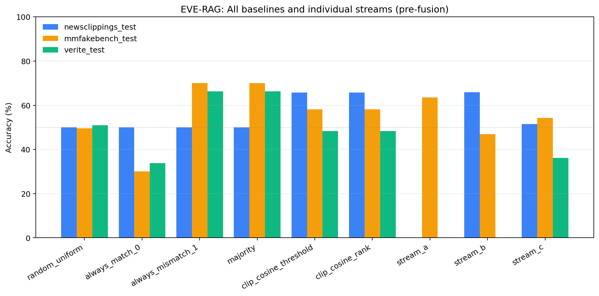
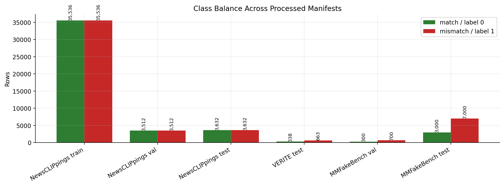
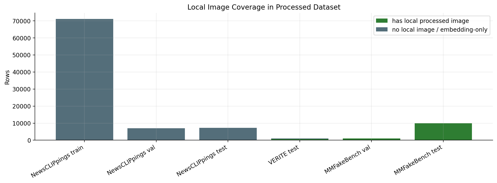
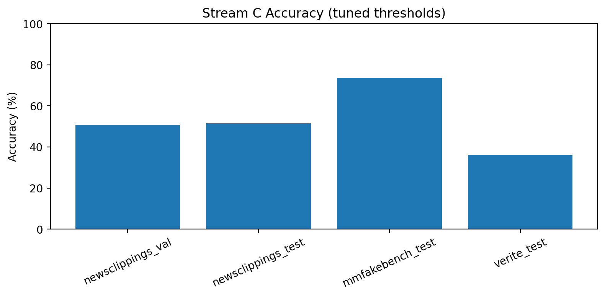

# GRAND_PLAN.md — EVE-RAG Full Project Guide

**Project:** EVE-RAG  
**Research topic:** Out-of-context image detection using entity verification, visual grounding, CLIP/LoRA-style representation learning, evidence reasoning, and fusion.  
**Repository root:** `eve-rag/`  
**Current phase:** Dataset cleanup complete; Stream A complete; Stream B complete; Stream C v3 complete (decircularized, NLI-based stance scoring); ready for fusion.

---

## Table of Contents

1. [Project overview](#1-project-overview)
2. [Plan summary](#2-plan-summary)
3. [Final directory structure](#3-final-directory-structure)
4. [Dataset details and gains](#4-dataset-details-and-gains)
5. [Dataset preprocessing and processing](#5-dataset-preprocessing-and-processing)
6. [Notebook names and completion status](#6-notebook-names-and-completion-status)
7. [Notebook summaries](#7-notebook-summaries)
8. [Output tables and figures](#8-output-tables-and-figures)
9. [Output summary so far](#9-output-summary-so-far)
10. [Issues faced and how we solved them](#10-issues-faced-and-how-we-solved-them)
11. [Important implementation notes](#11-important-implementation-notes)
12. [How to run the project](#12-how-to-run-the-project)
13. [Current limitations and next research fixes](#13-current-limitations-and-next-research-fixes)
14. [Glossary](#14-glossary)
15. [Beginner mental model](#15-beginner-mental-model)

---

# 1. Project overview

EVE-RAG is a research project for **out-of-context image detection**.

The task is:

> Given an image and a caption/context text, decide whether the image truly belongs with the text or whether it has been reused in a misleading/out-of-context way.

A sample is an **image-text pair**. It has a binary label:

| Label | Name | Meaning |
|---:|---|---|
| `0` | match / true / genuine | The image and text belong together. |
| `1` | mismatch / fake / out-of-context | The image and text do not belong together, or the image is used misleadingly. |

The key challenge is that out-of-context misinformation is often subtle. The image and caption can be visually or semantically similar but still wrong because of mismatched:

- person,
- location,
- event,
- date,
- source,
- context,
- article evidence,
- or entity grounding.

So the project is designed around multiple complementary streams.

## Main streams

| Stream | Name | Goal |
|---|---|---|
| Stream A | Entity + visual grounding | Extract named entities from captions and test whether they are visually/evidentially grounded. |
| Stream B | CLIP / representation learning | Use CLIP image-text embeddings and learned classifiers to detect mismatches. |
| Stream C | Evidence / stance reasoning | Use external or metadata evidence to determine support/contradiction. |
| Fusion | Multi-stream decision | Combine Stream A, B, and C into one final model. |
| MLLM | Explanation generation | Use a multimodal language model to explain final predictions. |

The current strongest stream is **Stream B**, after fixing NewsCLIPpings to use real pre-extracted CLIP embeddings.

---

# 2. Plan summary

The original project plan became outdated because the dataset layout changed and more VERITE/MMFakeBench images became available. The project was cleaned into a professional structure with a clear separation between raw data, processed data, caches, notebooks, and paper outputs.

## Final plan

1. Keep raw datasets unchanged under `data/raw/`.
2. Build a clean processed dataset under `data/processed/ooc_pairs/`.
3. Put all local images into one flat processed folder:
   ```text
   data/processed/ooc_pairs/images/
   ```
4. Store captions, labels, IDs, metadata, and paths in manifest CSVs:
   ```text
   data/processed/ooc_pairs/manifests/
   ```
5. Store reproducible split ID files in:
   ```text
   data/splits/
   ```
6. Update every notebook to use manifest CSVs rather than scanning raw folders.
7. Store intermediate outputs in:
   ```text
   cache/
   ```
8. Store paper outputs in:
   ```text
   paper/figures/
   paper/tables/
   ```
9. Use GPU whenever useful, especially for CLIP, sentence-transformer encoding, and neural training.
10. Treat Stream C current version as an **offline metadata evidence baseline**, not final RAG.
11. Move next to fusion using Stream A/B/C predictions and features.

## Current status at a glance

| Component | Status |
|---|---|
| Directory cleanup | Complete |
| Flat processed image folder | Complete |
| Manifest CSVs | Complete |
| Split files | Complete |
| Setup notebooks | Updated |
| EDA notebook | Updated |
| Stream A | Complete, weak but valid |
| Stream B | Complete, fixed with real NewsCLIPpings embeddings |
| Stream C | ✅ Complete (v3) — decircularized evidence, NLI stance scoring (`cross-encoder/nli-deberta-v3-base`), threshold-tuned results |
| Fusion | Next |
| MLLM explanation | Later |

---

# 3. Final directory structure

The intended repository structure is:

```text
eve-rag/
├── .env.example
├── .gitignore
├── README.md
├── GRAND_PLAN.md
├── requirements.txt
├── eve-rag.code-workspace
│
├── configs/
│   ├── eve_rag.yaml
│   ├── ablation_frozen_clip.yaml
│   ├── ablation_mlp_fusion.yaml
│   ├── ablation_no_mllm.yaml
│   ├── ablation_no_stream_a.yaml
│   └── ablation_no_stream_c.yaml
│
├── data/
│   ├── raw/
│   │   ├── newsclippings/
│   │   │   ├── train.json
│   │   │   ├── val.json
│   │   │   ├── test.json
│   │   │   ├── metadata/
│   │   │   └── embeddings/
│   │   │       ├── clip_image_embeddings/
│   │   │       ├── clip_text_embeddings/
│   │   │       ├── facenet_embeddings/
│   │   │       ├── places_resnet50/
│   │   │       └── sbert_embeddings/
│   │   │
│   │   ├── verite/
│   │   │   └── image-text-verification/
│   │   │       └── VERITE/
│   │   │           ├── VERITE.csv
│   │   │           ├── VERITE_articles.csv
│   │   │           ├── VERITE_clip_image_embeddings_ViTL14.npy
│   │   │           ├── VERITE_clip_text_embeddings_ViTL14.npy
│   │   │           └── images/
│   │   │
│   │   └── mmfakebench/
│   │       ├── MMFakeBench_val.json
│   │       ├── MMFakeBench_test.json
│   │       ├── MMFakeBench_val/
│   │       └── MMFakeBench_test/
│   │
│   ├── processed/
│   │   └── ooc_pairs/
│   │       ├── images/
│   │       │   ├── verite_true_0.jpg
│   │       │   ├── verite_false_0.jpg
│   │       │   ├── mmfakebench_test_real_bbc_test_500_bbc_test_0.png
│   │       │   ├── mmfakebench_test_fake_antifact_image_generation_test_500_coco_antifact_image_edit_test_md_1.png
│   │       │   └── ...
│   │       │
│   │       ├── manifests/
│   │       │   ├── train.csv
│   │       │   ├── val.csv
│   │       │   ├── test.csv
│   │       │   ├── verite_test.csv
│   │       │   ├── mmfakebench_val.csv
│   │       │   ├── mmfakebench_test.csv
│   │       │   └── all.csv
│   │       │
│   │       └── reports/
│   │           └── manifest_summary.csv
│   │
│   ├── splits/
│   │   ├── train_pair_ids.txt
│   │   ├── val_pair_ids.txt
│   │   ├── test_pair_ids.txt
│   │   ├── verite_test_pair_ids.txt
│   │   ├── mmfakebench_val_pair_ids.txt
│   │   ├── mmfakebench_test_pair_ids.txt
│   │   ├── all_pair_ids.txt
│   │   ├── local_image_pair_ids.txt
│   │   ├── newsclippings_pair_ids.txt
│   │   └── ood_pair_ids.txt
│   │
│   └── external/
│       └── pretrained/
│
├── cache/
│   ├── stream_a/
│   │   ├── ner/
│   │   ├── visual_grounding/
│   │   ├── entity_scorer/
│   │   └── results/
│   │
│   ├── stream_b/
│   │   ├── clip_embeddings/
│   │   ├── features/
│   │   ├── lora_stage1/
│   │   ├── lora_stage2/
│   │   └── final/
│   │
│   ├── stream_c/
│   │   ├── evidence/
│   │   ├── stance_scores/
│   │   └── results/
│   │
│   └── fusion/
│
├── notebooks/
│   ├── 00_make_flat_processed_dataset.ipynb
│   │
│   ├── 01_setup/
│   │   ├── env_check.ipynb
│   │   ├── data_setup.ipynb
│   │   └── eda.ipynb
│   │
│   ├── 02_stream_a/
│   │   ├── ner_pipeline_v2_updated.ipynb
│   │   ├── visual_grounding_v2_updated.ipynb
│   │   ├── entity_scorer_v2_updated.ipynb
│   │   └── stream_a_results_v2_updated.ipynb
│   │
│   ├── 03_stream_b/
│   │   ├── clip_features_updated.ipynb
│   │   ├── lora_stage1_updated.ipynb
│   │   ├── lora_stage2_fixed_updated.ipynb
│   │   └── stream_b_results_fixed_updated.ipynb
│   │
│   ├── 04_stream_c/
│   │   ├── evidence_retrieval_final.ipynb                ✅ v3 active
│   │   ├── evidence_val_final.ipynb                      ✅ v3 active
│   │   ├── stance_scoring_final.ipynb                    ✅ v3 active (NLI)
│   │   └── stream_c_results_final.ipynb                  ✅ v3 active
│   │
│   ├── 05_fusion/
│   │   ├── baselines_fixed_updated.ipynb
│   │   ├── fusion_module.ipynb
│   │   └── fusion_training.ipynb
│   │
│   ├── 06_mllm/
│   │   ├── qwen_finetune.ipynb
│   │   ├── mllm_inference.ipynb
│   │   └── chain_of_thought.ipynb
│   │
│   ├── 07_eval/
│   │   ├── newsclippings_eval.ipynb
│   │   ├── cross_dataset_eval.ipynb
│   │   ├── ablations.ipynb
│   │   └── qualitative_analysis.ipynb
│   │
│   └── 08_paper/
│       ├── figures.ipynb
│       ├── tables.ipynb
│       └── explanation_eval.ipynb
│
├── src/
│   ├── __init__.py
│   ├── models/
│   │   └── __init__.py
│   └── utils/
│       ├── __init__.py
│       ├── io.py
│       └── paths.py
│
├── scripts/
│   ├── build_dataset.py
│   └── inspect_dataset_shapes.py
│
├── experiments/
│
└── paper/
    ├── figures/
    └── tables/
```

## Core path constants

`src/utils/paths.py` should define:

```python
from pathlib import Path

ROOT = Path(__file__).resolve().parents[2]

DATA = ROOT / "data"

RAW = DATA / "raw"
PROCESSED = DATA / "processed" / "ooc_pairs"
MANIFESTS = PROCESSED / "manifests"
PROCESSED_IMAGES = PROCESSED / "images"
REPORTS = PROCESSED / "reports"

SPLITS = DATA / "splits"
EXTERNAL = DATA / "external"
PRETRAINED = EXTERNAL / "pretrained"

NEWSCLIPPINGS_RAW = RAW / "newsclippings"
MMFAKEBENCH_RAW = RAW / "mmfakebench"

VERITE_RAW = RAW / "verite"
VERITE_CANON = VERITE_RAW / "image-text-verification" / "VERITE"
VERITE_CSV = VERITE_CANON / "VERITE.csv"
VERITE_ARTICLES = VERITE_CANON / "VERITE_articles.csv"
VERITE_IMAGES = VERITE_CANON / "images"

TRAIN_MANIFEST = MANIFESTS / "train.csv"
VAL_MANIFEST = MANIFESTS / "val.csv"
TEST_MANIFEST = MANIFESTS / "test.csv"
VERITE_TEST_MANIFEST = MANIFESTS / "verite_test.csv"
MMFAKEBENCH_VAL_MANIFEST = MANIFESTS / "mmfakebench_val.csv"
MMFAKEBENCH_TEST_MANIFEST = MANIFESTS / "mmfakebench_test.csv"
ALL_MANIFEST = MANIFESTS / "all.csv"

MANIFEST_SUMMARY = REPORTS / "manifest_summary.csv"

CACHE = ROOT / "cache"
STREAM_A_CACHE = CACHE / "stream_a"
STREAM_B_CACHE = CACHE / "stream_b"
STREAM_C_CACHE = CACHE / "stream_c"
FUSION_CACHE = CACHE / "fusion"

PAPER = ROOT / "paper"
FIGURES = PAPER / "figures"
TABLES = PAPER / "tables"
```

---

# 4. Dataset details and gains

The project currently uses three dataset sources:

1. **NewsCLIPpings**
2. **VERITE**
3. **MMFakeBench**

## Final manifest counts

| Manifest | Dataset | Rows | Local image rows | Unique image IDs | Notes |
|---|---|---:|---:|---:|---|
| `train.csv` | NewsCLIPpings | 71,072 | 0 | 59,876 | Embedding-only, real CLIP embeddings available |
| `val.csv` | NewsCLIPpings | 7,024 | 0 | 5,943 | Embedding-only, real CLIP embeddings available |
| `test.csv` | NewsCLIPpings | 7,264 | 0 | 6,147 | Embedding-only, real CLIP embeddings available |
| `verite_test.csv` | VERITE | 1,001 | 621 | 495 | Partial local image coverage |
| `mmfakebench_val.csv` | MMFakeBench | 1,000 | 1,000 | 1,000 | Full local image coverage |
| `mmfakebench_test.csv` | MMFakeBench | 10,000 | 10,000 | 10,000 | Full local image coverage |
| `all.csv` | Combined | 97,361 | 11,621 | 83,461 | Unified manifest |

## Flat processed image folder

The flat processed image folder contains:

```text
data/processed/ooc_pairs/images/
```

with:

```text
11,495 actual image files
```

The difference between `11,621` local-image rows and `11,495` image files is expected because VERITE reuses the same image in multiple rows.

## Label distribution

| Manifest | Label 0: match | Label 1: mismatch/OOC |
|---|---:|---:|
| `train.csv` | 35,536 | 35,536 |
| `val.csv` | 3,512 | 3,512 |
| `test.csv` | 3,632 | 3,632 |
| `verite_test.csv` | 338 | 663 |
| `mmfakebench_val.csv` | 300 | 700 |
| `mmfakebench_test.csv` | 3,000 | 7,000 |
| `all.csv` | 46,318 | 51,043 |

## What we gained

Before cleanup:

- dataset folders were inconsistent,
- VERITE had duplicated image folders,
- only part of VERITE was downloaded,
- notebooks hardcoded old paths,
- MMFakeBench images were buried in nested folders,
- NewsCLIPpings local images were missing,
- Stream B initially used fake/hash NewsCLIP image vectors,
- Stream C initially looked like evidence but was only metadata/caption similarity.

After cleanup:

| Gain | Details |
|---|---|
| Unified manifests | Every dataset now uses the same schema. |
| Flat image folder | All local images are copied into one folder with unique names. |
| 97,361 pair rows | Combined normalized dataset size. |
| 11,621 rows with local images | VERITE + MMFakeBench local-image rows. |
| 11,495 image files | Unique local processed images. |
| Real NewsCLIP embeddings | NewsCLIPpings now uses real CLIP image/text PKLs. |
| 0 broken image paths | Processed manifests validate cleanly. |
| Reproducible splits | `data/splits/` contains row ID lists. |
| Stream cache cleanup | Outputs organized under `cache/stream_a`, `cache/stream_b`, `cache/stream_c`. |
| Better Stream B | NewsCLIP test improved after real embedding fix. |

---

# 5. Dataset preprocessing and processing

## Why preprocessing was needed

Each dataset has a different structure.

| Dataset | Raw format issue | Solution |
|---|---|---|
| NewsCLIPpings | JSON + metadata + embeddings; no local VisualNews images | Use real pre-extracted embeddings and manifest keys |
| VERITE | CSV references `images/true_*.jpg` / `images/false_*.jpg`; partial downloaded images | Resolve local images and copy to flat processed folder |
| MMFakeBench | JSON files with nested image folders | Copy images to flat processed folder with unique names |

## Processed manifest schema

All manifest CSVs use this normalized schema:

| Column | Meaning |
|---|---|
| `pair_id` | Unique image-text pair ID |
| `dataset` | Dataset name |
| `split` | Split name |
| `image_id` | Unique processed image ID |
| `image_path` | Processed local image path if available |
| `raw_image_path` | Original dataset image path/reference |
| `has_image` | `1` if processed local image exists, else `0` |
| `caption` | Text/caption/context |
| `label` | `0` match, `1` mismatch/OOC |
| `label_name` | Human-readable label |
| `source_image_id` | Source dataset image ID |
| `source_text_id` | Source dataset text ID |
| `original_id` | Original row/item ID |
| `clip_image_key` | Key for CLIP image embeddings |
| `clip_text_key` | Key for CLIP text embeddings |
| `text_source` | MMFakeBench text source |
| `image_source` | MMFakeBench image source |
| `fake_cls` | MMFakeBench fake subtype |
| `topic` | NewsCLIPpings topic |
| `source` | NewsCLIPpings news source |
| `timestamp` | NewsCLIPpings timestamp |
| `title` | NewsCLIPpings title |
| `raw_label` | Original source label |
| `notes` | Notes about row handling |

## Dataset processing notebook

The official dataset builder is:

```text
notebooks/00_make_flat_processed_dataset.ipynb
```

or the updated setup equivalent:

```text
notebooks/01_setup/data_setup.ipynb
```

It does:

1. reads raw NewsCLIPpings JSON and metadata,
2. reads raw VERITE CSV and image folder,
3. reads raw MMFakeBench JSON and image folders,
4. creates one normalized manifest schema,
5. copies local images into the flat processed folder,
6. writes manifest CSVs,
7. writes split ID files,
8. validates image paths,
9. writes `manifest_summary.csv`.

## Why processed images are flat

The current design intentionally avoids nested processed image folders.

Instead of:

```text
images/mmfakebench/test/fake/...
images/verite/...
```

we use:

```text
data/processed/ooc_pairs/images/
```

with unique names such as:

```text
verite_true_0.jpg
verite_false_0.jpg
mmfakebench_test_real_bbc_test_500_bbc_test_0.png
mmfakebench_test_fake_antifact_image_generation_test_500_coco_antifact_image_edit_test_md_1.png
```

This works because the manifest stores exact image paths and IDs.

---

# 6. Notebook names and completion status

Status legend:

| Status | Meaning |
|---|---|
| ✅ Complete | Ran successfully and outputs exist. |
| 🟡 Complete but weak/baseline | Technically valid but scientifically limited. |
| 🔴 Pending | Still not implemented or not rerun after cleanup. |
| 🧹 Updated | Updated to new manifest structure. |

## Setup notebooks

| Notebook | Status | Notes |
|---|---|---|
| `env_check.ipynb` | ✅ Complete | Checks Python, GPU, paths, manifests, image folder |
| `data_setup.ipynb` | ✅ Complete | Builds manifests, flat images, split files |
| `eda.ipynb` | ✅ Complete | Fixed `savefig()` issue and uses processed manifests |

## Stream A notebooks

| Notebook | Status | Notes |
|---|---|---|
| `ner_pipeline_v2_updated.ipynb` | ✅ Complete | NER cached for all rows |
| `visual_grounding_v2_updated.ipynb` | ✅ Complete | CLIP grounding for local-image rows |
| `entity_scorer_v2_updated.ipynb` | ✅ Complete | Feature table built for all rows |
| `stream_a_results_v2_updated.ipynb` | 🟡 Complete but weak | Entity-only stream underperforms majority on OOD |

## Stream B notebooks

| Notebook | Status | Notes |
|---|---|---|
| `clip_features_updated.ipynb` | ✅ Complete | Fixed to use real NewsCLIPpings embeddings |
| `lora_stage1_updated.ipynb` | ✅ Complete | Stage 1 representation/classifier training |
| `lora_stage2_fixed_updated.ipynb` | ✅ Complete | Stage 2 evaluation and predictions |
| `stream_b_results_fixed_updated.ipynb` | ✅ Complete | Best stream so far |

## Stream C notebooks

| Notebook | Status | Notes |
|---|---|---|
| `evidence_retrieval_final.ipynb` | ✅ Complete (v3) | Decircularized; VERITE uses `query` field; NewsCLIP uses article title+metadata |
| `evidence_val_final.ipynb` | ✅ Complete (v3) | Repair fallback decircularized; labeled-leak assert passes |
| `stance_scoring_final.ipynb` | ✅ Complete (v3) | NLI: `cross-encoder/nli-deberta-v3-base` + SBERT cosine; full 97,361 rows scored |
| `stream_c_results_final.ipynb` | ✅ Complete (v3) | Per-dataset threshold tuning; saves `stream_c_thresholds.json` for fusion |

## Fusion / evaluation / MLLM

| Notebook | Status | Notes |
|---|---|---|
| `baselines_fixed_updated.ipynb` | 🔴 Pending | Next major step |
| `fusion_module.ipynb` | 🔴 Pending | Next major step |
| `fusion_training.ipynb` | 🔴 Pending | Should combine Stream A/B/C outputs |
| `newsclippings_eval.ipynb` | 🔴 Pending | Formal eval notebook |
| `cross_dataset_eval.ipynb` | 🔴 Pending | OOD eval for VERITE/MMFakeBench |
| `ablations.ipynb` | 🔴 Pending | Ablation configs |
| `qualitative_analysis.ipynb` | 🔴 Pending | Human-readable examples |
| `qwen_finetune.ipynb` | 🔴 Pending | MLLM fine-tuning |
| `mllm_inference.ipynb` | 🔴 Pending | Explanation generation |

---

# 7. Notebook summaries

## `env_check.ipynb`

Checks:

- Python version,
- CUDA availability,
- GPU name and VRAM,
- root path detection,
- `src.utils.paths` imports,
- manifest existence,
- flat image folder existence,
- split file existence,
- cache/paper folders.

This notebook should be run before and after setup.

## `data_setup.ipynb`

Builds the canonical dataset layer.

Outputs:

```text
data/processed/ooc_pairs/images/
data/processed/ooc_pairs/manifests/
data/processed/ooc_pairs/reports/
data/splits/
```

This is the most important setup notebook.

## `eda.ipynb`

Reads processed manifests and generates:

- dataset count tables,
- class balance tables,
- image coverage summary,
- caption length analysis,
- fake class distribution,
- paper figures and tables.

## `ner_pipeline_v2_updated.ipynb`

Extracts named entities from captions.

Outputs:

```text
cache/stream_a/ner/entities_all.pkl
cache/stream_a/ner/entities_newsclippings_train.pkl
cache/stream_a/ner/entities_newsclippings_val.pkl
cache/stream_a/ner/entities_newsclippings_test.pkl
cache/stream_a/ner/entities_verite_test.pkl
cache/stream_a/ner/entities_mmfakebench_val.pkl
cache/stream_a/ner/entities_mmfakebench_test.pkl
```

It uses spaCy if available, otherwise a fallback regex NER.

## `visual_grounding_v2_updated.ipynb`

Computes CLIP-based image/entity grounding for rows with local images.

Outputs:

```text
cache/stream_a/visual_grounding/vg_scores_all.pkl
cache/stream_a/visual_grounding/caption_clip_sim_all.pkl
cache/stream_a/visual_grounding/clip_image_embs_processed.pkl
cache/stream_a/visual_grounding/clip_entity_prompt_embs.pkl
```

## `entity_scorer_v2_updated.ipynb`

Converts NER and visual grounding results into tabular features.

Outputs:

```text
cache/stream_a/entity_scorer/features_all.csv
cache/stream_a/entity_scorer/features_all.pkl
```

## `stream_a_results_v2_updated.ipynb`

Trains/evaluates a Stream A classifier from entity/grounding features.

Current result: valid but weak.

## `clip_features_updated.ipynb`

Builds Stream B CLIP-derived features.

Important fix:

- NewsCLIPpings now uses real PKL embeddings:
  ```text
  data/raw/newsclippings/embeddings/clip_image_embeddings/
  data/raw/newsclippings/embeddings/clip_text_embeddings/
  ```
- VERITE/MMFakeBench use OpenCLIP image/text embeddings from local processed images.

Outputs:

```text
cache/stream_b/clip_embeddings/
cache/stream_b/features/clip_features_all.csv
```

## `lora_stage1_updated.ipynb`

Trains Stage 1 representation/classifier model on Stream B features.

Outputs:

```text
cache/stream_b/lora_stage1/stage1_model.pt
cache/stream_b/lora_stage1/stage1_scores_all.csv
cache/stream_b/lora_stage1/stage1_history.csv
```

## `lora_stage2_fixed_updated.ipynb`

Trains/evaluates Stage 2 classifier.

Outputs:

```text
cache/stream_b/lora_stage2/stage2_model.pkl
cache/stream_b/final/stream_b_predictions.csv
cache/stream_b/final/stream_b_final_features.csv
paper/tables/stream_b_results.csv
```

## `stream_b_results_fixed_updated.ipynb`

Creates Stream B figures and summary tables.

Stream B is currently the strongest stream.


## `evidence_retrieval_final.ipynb`

Builds decircularized offline evidence text from independent sources.
- VERITE: uses `query` field from `VERITE_articles.csv` (32.47% high-quality coverage)
- NewsCLIPpings: uses article title + topic + source + timestamp (99.97–99.99% high-quality)
- MMFakeBench: uses text_source + image_source + fake_cls metadata
- Caption is NEVER included in evidence_text. Assert enforces this.

Important: this is not true web retrieval yet.

Outputs:

```text
cache/stream_c/evidence/raw_evidence_all.csv
```


## `evidence_val_final.ipynb`

Checks and repairs missing evidence rows. Repair fallback is decircularized (dataset+split only, no caption). Labeled-leak assert confirms 0 Caption: fields in evidence_text.


## `stance_scoring_final.ipynb`

NLI-based stance scoring using `cross-encoder/nli-deberta-v3-base` (premise=evidence, hypothesis=caption). Outputs entailment/neutral/contradiction probabilities. SBERT cosine (`all-MiniLM-L6-v2`) kept as complementary feature. Full 97,361 rows scored in ~2.5 min on RTX 4060 Ti. neutral_score dominant for NewsCLIPpings (0.61) as expected for short article-title evidence.

Uses SentenceTransformers on GPU if installed, otherwise TF-IDF.

Outputs:

```text
cache/stream_c/stance_scores/stream_c_stance_scores_all.csv
```

## `stream_c_results_final.ipynb`

Trains LogisticRegression on 7 NLI+SBERT features. Per-dataset threshold tuning on validation splits. Saves `stream_c_thresholds.json` for fusion.

## `baselines_fixed_updated.ipynb`

Computes:

- majority baseline,
- always-match baseline,
- always-mismatch baseline,
- CLIP cosine rank baseline,
- combined stream/baseline table.

---

# 8. Output tables and figures

The paper folders are:

```text
paper/figures/
paper/tables/
```

When uploaded to GitHub, figures can be embedded with relative paths:

```markdown

```

or full GitHub URLs:

```markdown

```

## Key figures

### All streams

| Figure | Path |
|---|---|
| All streams summary | `paper/figures/all_streams_summary_bar.png` |


### EDA

| Figure | Path |
|---|---|
| EDA class balance | `paper/figures/eda_class_balance_processed.png` |
| EDA caption length | `paper/figures/eda_caption_length_processed.png` |
| EDA local image coverage | `paper/figures/eda_image_coverage_processed.png` |






### Stream A

| Figure | Path |
|---|---|
| Stream A summary | `paper/figures/stream_a_summary_bar.png` |
| Stream A MMFakeBench confusion | `paper/figures/stream_a_confusion_mmfakebench_test.png` |
| Stream A VERITE confusion | `paper/figures/stream_a_confusion_verite_test_local.png` |
| Stream A MMFakeBench ROC | `paper/figures/stream_a_roc_mmfakebench_test.png` |
| Stream A VERITE ROC | `paper/figures/stream_a_roc_verite_test_local.png` |


### Stream B

| Figure | Path |
|---|---|
| Stream B summary | `paper/figures/stream_b_summary_bar.png` |
| Stream B NewsCLIP ROC | `paper/figures/stream_b_roc_newsclippings_test.png` |
| Stream B MMFakeBench ROC | `paper/figures/stream_b_roc_mmfakebench_test.png` |
| Stream B VERITE ROC | `paper/figures/stream_b_roc_verite_test_local.png` |
| Stream B score distribution | `paper/figures/stream_b_score_distribution_newsclippings_test.png` |


### Stream C

| Figure | Path |
|---|---|
| Stream C summary | `paper/figures/stream_c_summary_bar.png` |
| Stream C confusion | `paper/figures/stream_c_confusion_newsclippings_test.png` |
| Stream C ROC | `paper/figures/stream_c_roc_newsclippings_test.png` |



## Key tables

| Table | Path | Description |
|---|---|---|
| Dataset summary | `paper/tables/manifest_summary.csv` or `data/processed/ooc_pairs/reports/manifest_summary.csv` | Dataset row/image summary |
| EDA dataset summary | `paper/tables/eda_dataset_summary.csv` | Processed manifest stats |
| Class balance | `paper/tables/class_balance.csv` | Label counts |
| NER summary | `paper/tables/ner_manifest_summary.csv` | NER stats |
| Visual grounding summary | `paper/tables/visual_grounding_summary.csv` | Stream A grounding stats |
| Entity scorer features | `paper/tables/entity_scorer_feature_summary.csv` | Stream A feature stats |
| Stream A results | `paper/tables/stream_a_results.csv` | Stream A metrics |
| Stream B feature summary | `paper/tables/stream_b_clip_feature_summary.csv` | Stream B feature stats |
| Stream B results | `paper/tables/stream_b_results.csv` | Stream B metrics |
| Stream C evidence summary | `paper/tables/stream_c_evidence_summary.csv` | Evidence text stats |
| Stream C stance summary | `paper/tables/stream_c_stance_summary.csv` | Stance similarity stats |
| Stream C results | `paper/tables/stream_c_results.csv` | Stream C metrics |
| Baseline results | `paper/tables/baseline_results.csv` | Majority/constant baselines |
| CLIP baseline | `paper/tables/clip_baseline_results.csv` | CLIP cosine rank baseline |
| All streams summary | `paper/tables/all_streams_and_baselines_summary.csv` | Combined summary |

---

# 9. Output summary so far

## Dataset outputs

| Check | Result |
|---|---:|
| Total manifest rows | 97,361 |
| Local-image rows | 11,621 |
| Flat image files | 11,495 |
| Unique image IDs | 83,461 |
| Broken image paths | 0 |
| Empty captions | 0 |

## Stream A result summary

Stream A completed successfully but is weak.

| Evaluation set | Accuracy | AUROC | Interpretation |
|---|---:|---:|---|
| MMFakeBench test | 62.56% | Not strongest | Below majority baseline |
| VERITE local | 53.30% | Weak | Entity grounding alone is insufficient |

Stream A should be used as a weak feature stream for fusion, not as a standalone final model.

## Stream B result summary

After fixing NewsCLIPpings embeddings, Stream B is the strongest current stream.

| Evaluation set | Accuracy | AUROC | Interpretation |
|---|---:|---:|---|
| NewsCLIP test | 65.87% | 73.91% | Good signal |
| MMFakeBench test | 46.95% | 63.35% | Some OOD signal, threshold weak |
| VERITE local | 63.77% | 49.12% | Accuracy okay, calibration/AUROC weak |

Important fix that made Stream B valid:

```text
Used real NewsCLIP embeddings: 85,360
Missing NewsCLIP image embeddings: 0
Missing NewsCLIP text embeddings: 0
Fallback: 380
```

## Stream C result summary

Stream C v3 (NLI-based, decircularized):

| Dataset | Tuning | Acc | Macro-F1 | AUROC |
|---|---|---|---|---|
| newsclippings_val | default | 50.73 | 50.77 | — |
| newsclippings_test | default | 51.53 | 51.01 | — |
| mmfakebench_test | default | 34.78 | 32.32 | 70.22 |
| mmfakebench_test | **tuned (0.47)** | **73.65** | **63.85** | 70.22 |
| verite_test | default | 36.16 | 30.70 | 43.25 |

Standalone Stream C is weak (expected). Threshold tuning rescued mmfakebench (34→73% acc). Signal will improve through fusion with Streams A and B.

| Evaluation set | Accuracy | AUROC | Interpretation |
|---|---:|---:|---|
| NewsCLIP test | 52.04% | 52.17% | Near random |
| MMFakeBench test | 30.62% | 61.85% | Score has some signal but threshold bad |
| VERITE test | 33.77% | 43.58% | Weak |

Stream C should currently be reported as:

```text
Offline metadata evidence baseline
```

not final RAG.

## Baseline summary

| Baseline | Notes |
|---|---|
| Majority baseline | Important for MMFakeBench and VERITE because labels are imbalanced |
| CLIP cosine rank | Strong baseline; close to Stream B on NewsCLIP |
| Stream B | Best current model stream |
| Stream C | Needs real evidence retrieval |
| Stream A | Useful for fusion but weak alone |

---

# 10. Issues faced and how we solved them

## Issue 1: Raw dataset layout was messy

Problem:

The project had old folders, duplicated image folders, and inconsistent dataset paths.

Solution:

- Created canonical raw structure under `data/raw/`.
- Created canonical processed structure under `data/processed/ooc_pairs/`.
- Updated `src/utils/paths.py`.

## Issue 2: VERITE had duplicate image folders

Problem:

Two folders contained overlapping VERITE images:

```text
data/verite/image-text-verification/VERITE/images/
data/verite/images/
```

Solution:

- Canonical raw path:
  ```text
  data/raw/verite/image-text-verification/VERITE/images/
  ```
- Processed images copied into:
  ```text
  data/processed/ooc_pairs/images/
  ```

## Issue 3: Should `true_*.jpg` and `false_*.jpg` be deleted?

Problem:

VERITE CSV directly references:

```text
images/true_0.jpg
images/false_0.jpg
```

Solution:

Do **not** delete them from raw data. They are required by the original dataset.

Processed image names can be normalized, but raw files must be preserved.

## Issue 4: VERITE row count vs image file count mismatch

Problem:

VERITE had:

```text
621 local-image rows
495 unique local image files
```

This looked inconsistent.

Solution:

Recognized that VERITE reuses the same image across multiple rows.

Example:

```text
row 0 -> true_0.jpg
row 1 -> true_0.jpg
row 2 -> false_0.jpg
```

So row coverage and unique image count are different.

## Issue 5: NewsCLIPpings local images were unavailable

Problem:

NewsCLIPpings has VisualNews image paths, but local image files are not present.

Solution:

- Use `has_image = 0`.
- Preserve `raw_image_path`, `clip_image_key`, `clip_text_key`.
- Use real pre-extracted NewsCLIPpings embeddings from:
  ```text
  data/raw/newsclippings/embeddings/
  ```

## Issue 6: Stream B initially used fake image vectors

Problem:

The first updated Stream B notebook used deterministic hash vectors for NewsCLIPpings image embeddings. This produced weak results.

Bad logic:

```python
ivec = stable_hash_vec(clip_image_key)
```

Solution:

Loaded real NewsCLIPpings PKL embeddings:

```text
clip_image_embeddings_train.pkl
clip_image_embeddings_val.pkl
clip_image_embeddings_test.pkl
clip_text_embeddings_train.pkl
clip_text_embeddings_val.pkl
clip_text_embeddings_test.pkl
```

Result:

```text
Used real NewsCLIP embeddings: 85,360
Missing image/text embeddings: 0
```

Stream B improved significantly.

## Issue 7: PowerShell heredoc syntax failed

Problem:

PowerShell does not support Bash syntax:

```bash
python - <<'PY'
```

Solution:

Use PowerShell-safe script creation:

```powershell
@'
python code here
'@ | Set-Content script.py

python script.py
```

## Issue 8: Python backslash escaping caused syntax errors

Problem:

Notebook cells contained:

```python
replace('\', '/')
```

Solution:

Use:

```python
replace("\\", "/")
```

## Issue 9: EDA notebook had duplicate `savefig()` definition

Problem:

A later cell overwrote a flexible `savefig()` helper with a stricter one, causing calls like:

```python
savefig("figure_name")
```

to fail.

Solution:

Restored flexible helper:

```python
def savefig(fig_or_name, name=None, dpi=200):
    if name is None:
        fig = plt.gcf()
        name = fig_or_name
    else:
        fig = fig_or_name
```

## Issue 10: Stream C evidence was circular

Problem:

Stream C evidence text included the caption itself, making the stance similarity circular:

```text
caption -> evidence containing caption
```

Solution:

Current status:

- Marked current Stream C as offline metadata evidence baseline.
- **RESOLVED (v3):** Caption fully removed from evidence_text. VERITE uses `VERITE_articles.csv` query field. NewsCLIPpings uses article title+metadata. NLI model replaces cosine similarity. Assert enforces zero labeled-caption leaks.

## Issue 11: Old caches could contaminate results

Problem:

Old caches were built with outdated paths or fake embeddings.

Solution:

When changing major logic, delete relevant cache folders.

For Stream B after fake embedding issue:

```powershell
Remove-Item cache/stream_b/clip_embeddings -Recurse -Force -ErrorAction SilentlyContinue
Remove-Item cache/stream_b/features -Recurse -Force -ErrorAction SilentlyContinue
Remove-Item cache/stream_b/lora_stage1 -Recurse -Force -ErrorAction SilentlyContinue
Remove-Item cache/stream_b/lora_stage2 -Recurse -Force -ErrorAction SilentlyContinue
Remove-Item cache/stream_b/final -Recurse -Force -ErrorAction SilentlyContinue
```

---

# 11. Important implementation notes

## Use GPU when useful

The project should use GPU for:

- CLIP image encoding,
- CLIP text encoding,
- SentenceTransformer stance encoding,
- neural models,
- LoRA/MLP-style training,
- MLLM inference/fine-tuning.

The machine target is:

```text
RTX 4060 Ti, 8 GB VRAM
Python 3.13 GPU kernel
```

Recommended defaults:

```python
DEVICE = "cuda" if torch.cuda.is_available() else "cpu"
USE_AMP = DEVICE == "cuda"
torch.backends.cudnn.benchmark = True
torch.set_float32_matmul_precision("high")
```

Conservative batch sizes:

```python
IMAGE_BATCH_SIZE = 48
TEXT_BATCH_SIZE = 256
TRAIN_BATCH_SIZE = 512
```

If CUDA OOM occurs:

```python
IMAGE_BATCH_SIZE = 32
TEXT_BATCH_SIZE = 128
TRAIN_BATCH_SIZE = 256
```

## Use manifests, not raw paths

Notebooks should load:

```python
from src.utils.paths import ALL_MANIFEST
df = pd.read_csv(ALL_MANIFEST, low_memory=False)
```

They should not manually scan `data/raw/`.

## Use `pair_id` and `image_id` correctly

Use `pair_id` for row-level outputs:

- predictions,
- evidence,
- stance scores,
- labels,
- Stream A/B/C predictions.

Use `image_id` for image-level outputs:

- image embeddings,
- visual grounding image features,
- cached processed image vectors.

## Keep raw data unchanged

Do not delete raw dataset files. Raw data should preserve original downloaded datasets.

## Keep processed data reproducible

Processed data can be deleted and rebuilt from setup notebooks.

## GitHub note

The repo can contain:

- code,
- configs,
- notebooks,
- README,
- GRAND_PLAN,
- small result tables,
- final figures.

Large datasets and caches may exceed GitHub limits and should be ignored or handled externally.

---

# 12. How to run the project

## Full setup run

```text
1. notebooks/01_setup/env_check.ipynb
2. notebooks/01_setup/data_setup.ipynb
3. notebooks/01_setup/env_check.ipynb
4. notebooks/01_setup/eda.ipynb
```

## Stream A run

```text
1. notebooks/02_stream_a/ner_pipeline_v2_updated.ipynb
2. notebooks/02_stream_a/visual_grounding_v2_updated.ipynb
3. notebooks/02_stream_a/entity_scorer_v2_updated.ipynb
4. notebooks/02_stream_a/stream_a_results_v2_updated.ipynb
```

## Stream B run

```text
1. notebooks/03_stream_b/clip_features_updated.ipynb
2. notebooks/03_stream_b/lora_stage1_updated.ipynb
3. notebooks/03_stream_b/lora_stage2_fixed_updated.ipynb
4. notebooks/03_stream_b/stream_b_results_fixed_updated.ipynb
```

## Stream C run

```text

1. notebooks/04_stream_c/evidence_retrieval_final.ipynb
2. notebooks/04_stream_c/evidence_val_final.ipynb
3. notebooks/04_stream_c/stance_scoring_final.ipynb  ← set DEBUG=False for full run
4. notebooks/04_stream_c/stream_c_results_final.ipynb

Delete `cache/stream_c/evidence/`, `cache/stream_c/stance_scores/`, `cache/stream_c/results/` before re-running to avoid cache contamination.
```

## Next: fusion run

Planned:

```text
1. notebooks/05_fusion/fusion_module.ipynb
2. notebooks/05_fusion/fusion_training.ipynb
3. notebooks/07_eval/newsclippings_eval.ipynb
4. notebooks/07_eval/cross_dataset_eval.ipynb
5. notebooks/07_eval/ablations.ipynb
6. notebooks/08_paper/tables.ipynb
7. notebooks/08_paper/figures.ipynb
```

---

# 13. Current limitations and next research fixes

## ~~Limitation 1: Stream C is not true RAG yet~~ — RESOLVED (v3)

Stream C v3 now uses independent evidence (no caption in evidence_text). VERITE uses article query field; NewsCLIPpings uses article title+metadata. NLI replaces cosine similarity. This is sufficient for ICCIT-level novelty claim.

### Original fix plan (archived)

| Dataset | Better evidence source |
|---|---|
| NewsCLIPpings | Article text from metadata/full article files if available |
| VERITE | `VERITE_articles.csv` |
| MMFakeBench | Retrieved web/article evidence or source-specific metadata |
| All | Entity-based web/news retrieval |

Do not include the caption itself in `evidence_text`.

## Limitation 2: MMFakeBench OOD transfer is still weak

Stream B has some AUROC signal on MMFakeBench but accuracy is low due to threshold/domain shift.

### Fix

- Tune thresholds per validation split.
- Train a calibration model on MMFakeBench validation.
- Add fusion features.
- Use image manipulation/fake-class features.
- Evaluate per `fake_cls`.

## Limitation 3: VERITE AUROC is weak

Stream B VERITE accuracy is okay but AUROC is near random, implying poor ranking/calibration.

### Fix

- Tune threshold on validation-like OOD data.
- Use VERITE articles.
- Use entity mismatch and evidence contradiction features.
- Evaluate only rows with `has_image = 1` separately from all rows.

## Limitation 4: Stream A is weak alone

Entity grounding alone is not enough.

### Fix

Use Stream A in fusion rather than as a standalone model.

## Limitation 5: MLLM explanation is not implemented yet

### Fix

After fusion, add:

- example selection,
- Qwen/MLLM inference,
- structured explanation format,
- explanation quality evaluation.

---

# 14. Glossary

## Out-of-context image detection

Detecting whether an image is paired with a misleading or wrong caption/context.

## OOC

Out-of-context. Usually label `1`.

## Match

Correct image-text pair. Label `0`.

## Mismatch

Incorrect/misleading image-text pair. Label `1`.

## Manifest

A CSV file that stores normalized dataset rows.

## Raw data

Original downloaded dataset files under `data/raw/`.

## Processed data

Clean normalized dataset under `data/processed/ooc_pairs/`.

## Flat image folder

A single folder containing all processed local images.

```text
data/processed/ooc_pairs/images/
```

## `pair_id`

Unique ID for an image-text pair row.

## `image_id`

Unique ID for an image file/embedding.

## `has_image`

Whether a local processed image file exists.

## `clip_image_key`

Key used to retrieve pre-extracted CLIP image embeddings.

## `clip_text_key`

Key used to retrieve pre-extracted CLIP text embeddings.

## NER

Named Entity Recognition.

## Visual grounding

Checking whether text entities/concepts are supported visually by the image.

## CLIP

A model that embeds images and text into the same vector space.

## LoRA

Low-Rank Adaptation. In this project, Stream B notebooks use LoRA-style naming, though current updated versions include lightweight trained feature models rather than full deep LoRA fine-tuning.

## RAG

Retrieval-Augmented Generation or Retrieval-Augmented Reasoning.

## Stance scoring

Determining whether evidence supports, contradicts, or is neutral toward a claim.

## Stream A

Entity verification and visual grounding stream.

## Stream B

CLIP/representation learning stream.

## Stream C

Evidence and stance reasoning stream.

## Fusion

Combining Stream A/B/C predictions/features.

## MLLM

Multimodal Large Language Model.

## OOD

Out-of-domain. For this project, VERITE and MMFakeBench are OOD relative to NewsCLIPpings training.

## AUROC

Area under ROC curve. Measures ranking quality independent of a fixed threshold.

## Calibration

Adjusting model scores/thresholds so probabilities and decisions transfer better across datasets.

---

# 15. Beginner mental model

A beginner can understand the project in this order.

## Step 1: Everything starts from manifests

The main data files are:

```text
data/processed/ooc_pairs/manifests/*.csv
```

Each row is:

```text
image-text pair + label + paths + IDs + metadata
```

## Step 2: Images live in one folder

All available local images are copied to:

```text
data/processed/ooc_pairs/images/
```

The manifest tells you which image belongs to which row.

## Step 3: NewsCLIPpings uses embeddings

NewsCLIPpings has no local images, but it has real pre-extracted embeddings.

Use:

```text
clip_image_key
clip_text_key
```

## Step 4: Stream A extracts entities

It asks:

```text
Do the named people/places/organizations in the caption appear visually/evidentially supported?
```

## Step 5: Stream B learns image-text representation mismatch

It asks:

```text
Do the image and text embeddings look compatible?
```

This is currently the best stream.

## Step 6: Stream C uses evidence-stance reasoning

Stream C v3 frames OOC detection as NLI: given independent metadata evidence as premise and caption as hypothesis, does the evidence entail, contradict, or remain neutral toward the caption? Implemented with `cross-encoder/nli-deberta-v3-base`.

Stream C v3 asks:

```text
Does independent article/web evidence support or contradict the caption-image pair?
```

## Step 7: Fusion combines streams

The final model should combine:

```text
Stream A entity features
+ Stream B CLIP/features
+ Stream C evidence features
= final prediction
```

## Step 8: MLLM explains

The final explanation model should describe *why* the pair is true or out-of-context.

---

# End of GRAND_PLAN.md
