# GRAND_PLAN.md — EVE-RAG Project Guide

**Project:** EVE-RAG: Entity-aware, Evidence-aware, Retrieval-augmented Out-of-Context Image Detection  
**Repository root:** `eve-rag/`  
**Current project phase:** dataset cleanup completed; manifest layer rebuilt; notebooks now need to be migrated to the processed manifest layer.  
**Last major update:** after restructuring raw/processed data and building the flat processed image folder.

---

## Table of Contents

1. [What this project is about](#1-what-this-project-is-about)
2. [Plan summary](#2-plan-summary)
3. [Final directory structure](#3-final-directory-structure)
4. [Dataset details and what we gained](#4-dataset-details-and-what-we-gained)
5. [Dataset preprocessing and processing](#5-dataset-preprocessing-and-processing)
6. [Notebook names and completion status](#6-notebook-names-and-completion-status)
7. [Notebook summaries](#7-notebook-summaries)
8. [Outputs: tables and figures](#8-outputs-tables-and-figures)
9. [Output summary so far](#9-output-summary-so-far)
10. [Issues faced and how we solved them](#10-issues-faced-and-how-we-solved-them)
11. [How to use the project now](#11-how-to-use-the-project-now)
12. [Important implementation notes](#12-important-implementation-notes)
13. [Glossary](#13-glossary)
14. [Beginner mental model](#14-beginner-mental-model)
15. [Next steps](#15-next-steps)

---

# 1. What this project is about

This project studies **out-of-context image detection**.

The basic problem is:

> Given an image and a caption/context text, decide whether the image truly belongs with the text.

A pair can be:

| Label | Meaning | Example |
|---:|---|---|
| `0` | match / truthful / in-context | The caption describes the actual image. |
| `1` | mismatch / falsified / out-of-context | The image is reused with a misleading caption or mismatched context. |

The project is called **EVE-RAG** because the intended method combines:

- **EVE**: entity verification and visual grounding
- **RAG**: retrieval-augmented evidence reasoning
- **CLIP / LoRA / MLLM**: multimodal representation learning and explanation

The high-level idea is that simple image-text similarity is not enough. A fake/out-of-context pair can still look semantically similar. For example, both caption and image may mention "protest", "soldiers", or "politicians", while the actual person, location, date, or event differs.

So the project investigates three main streams:

| Stream | Name | Core idea |
|---|---|---|
| Stream A | Entity verification | Extract named entities from text and compare them against visual/evidence cues. |
| Stream B | CLIP / LoRA representation stream | Use CLIP-style multimodal embeddings, domain adaptation, and learned classifiers. |
| Stream C | Evidence / stance stream | Retrieve or use external/contextual evidence and score whether it supports the caption-image pair. |

The final intended direction is a fusion model that combines these streams, followed by optional MLLM reasoning for explanations.

---

# 2. Plan summary

The old plan assumed the datasets and notebooks could directly read raw folders. That became messy because:

1. raw datasets had different formats,
2. VERITE images were incomplete and duplicated across folders,
3. NewsCLIPpings does not have local VisualNews images available,
4. MMFakeBench has many nested image folders,
5. notebooks used different hardcoded paths,
6. caches and old figures/tables were produced from outdated paths.

The new plan is:

1. Keep raw datasets unchanged under `data/raw/`.
2. Build one professional processed dataset layer under `data/processed/ooc_pairs/`.
3. Put all locally available processed images into one flat folder:
   ```text
   data/processed/ooc_pairs/images/
   ```
4. Store all labels, captions, IDs, source metadata, and image paths in CSV manifests:
   ```text
   data/processed/ooc_pairs/manifests/
   ```
5. Keep train/val/test experiment split files later under:
   ```text
   data/splits/
   ```
6. Update every notebook so it reads the manifest CSVs instead of manually scanning raw folders.
7. Treat `pair_id` as the main row key and `image_id` as the processed image key.
8. For NewsCLIPpings, use pre-extracted embeddings instead of local images.
9. For VERITE and MMFakeBench, use local flat processed images.
10. Rebuild Stream A/B/C outputs from this manifest layer.

The project now has a clean separation:

```text
raw data      = original downloaded datasets
processed     = normalized project dataset
cache         = intermediate model features
paper         = figures/tables/results
notebooks     = experiments and analysis
src           = reusable code
```

---

# 3. Final directory structure

The intended professional repo structure is:

```text
eve-rag/
├── .gitignore
├── README.md
├── GRAND_PLAN.md
├── requirements.txt
├── configs/
│   ├── eve_rag.yaml
│   ├── ablation_frozen_clip.yaml
│   ├── ablation_mlp_fusion.yaml
│   ├── ablation_no_mllm.yaml
│   ├── ablation_no_stream_a.yaml
│   └── ablation_no_stream_c.yaml
│
├── data/
│   ├── raw/
│   │   ├── newsclippings/
│   │   ├── verite/
│   │   │   └── image-text-verification/
│   │   │       └── VERITE/
│   │   │           ├── VERITE.csv
│   │   │           ├── VERITE_articles.csv
│   │   │           ├── VERITE_clip_image_embeddings_ViTL14.npy
│   │   │           ├── VERITE_clip_text_embeddings_ViTL14.npy
│   │   │           └── images/
│   │   └── mmfakebench/
│   │       ├── MMFakeBench_val.json
│   │       ├── MMFakeBench_test.json
│   │       ├── MMFakeBench_val/
│   │       └── MMFakeBench_test/
│   │
│   ├── processed/
│   │   └── ooc_pairs/
│   │       ├── images/
│   │       │   ├── verite_true_0.jpg
│   │       │   ├── verite_false_0.jpg
│   │       │   ├── mmfakebench_test_real_bbc_test_500_bbc_test_0.png
│   │       │   ├── mmfakebench_test_fake_antifact_image_generation_test_500_coco_antifact_image_edit_test_md_1.png
│   │       │   └── ...
│   │       │
│   │       ├── manifests/
│   │       │   ├── train.csv
│   │       │   ├── val.csv
│   │       │   ├── test.csv
│   │       │   ├── verite_test.csv
│   │       │   ├── mmfakebench_val.csv
│   │       │   ├── mmfakebench_test.csv
│   │       │   └── all.csv
│   │       │
│   │       └── reports/
│   │           └── manifest_summary.csv
│   │
│   ├── splits/
│   │   └── future custom split files go here
│   │
│   └── external/
│       └── pretrained/
│
├── cache/
│   ├── stream_a/
│   │   ├── ner/
│   │   ├── visual_grounding/
│   │   └── entity_scorer/
│   │
│   ├── stream_b/
│   │   ├── clip_embeddings/
│   │   ├── features/
│   │   ├── lora_stage1/
│   │   ├── lora_stage2/
│   │   └── final/
│   │
│   ├── stream_c/
│   │   ├── evidence/
│   │   └── stance_scores/
│   │
│   └── fusion/
│
├── notebooks/
│   ├── 00_make_flat_processed_dataset.ipynb
│   │
│   ├── 01_setup/
│   │   ├── env_check.ipynb
│   │   ├── data_download.ipynb
│   │   └── eda.ipynb
│   │
│   ├── 02_stream_a/
│   │   ├── ner_pipeline_v2.ipynb
│   │   ├── visual_grounding_v2.ipynb
│   │   └── stream_a_results_v2_fixed.ipynb
│   │
│   ├── 03_stream_b/
│   │   ├── clip_features.ipynb
│   │   ├── lora_stage1.ipynb
│   │   ├── lora_stage2_fixed.ipynb
│   │   └── stream_b_results_fixed.ipynb
│   │
│   ├── 04_stream_c/
│   │   ├── evidence_retrieval_patch_fixed.ipynb
│   │   ├── evidence_val_fix.ipynb
│   │   ├── stance_scoring_fixed.ipynb
│   │   └── stream_c_results_fixed.ipynb
│   │
│   ├── 05_fusion/
│   │   ├── baselines_fixed.ipynb
│   │   ├── fusion_module.ipynb
│   │   └── fusion_training.ipynb
│   │
│   ├── 06_mllm/
│   │   ├── qwen_finetune.ipynb
│   │   ├── mllm_inference.ipynb
│   │   └── chain_of_thought.ipynb
│   │
│   ├── 07_eval/
│   │   ├── newsclippings_eval.ipynb
│   │   ├── cross_dataset_eval.ipynb
│   │   ├── ablations.ipynb
│   │   └── qualitative_analysis.ipynb
│   │
│   └── 08_paper/
│       ├── figures.ipynb
│       ├── tables.ipynb
│       └── explanation_eval.ipynb
│
├── src/
│   ├── __init__.py
│   ├── models/
│   │   └── __init__.py
│   └── utils/
│       ├── __init__.py
│       ├── io.py
│       └── paths.py
│
├── scripts/
│   └── build_dataset.py
│
├── experiments/
│
└── paper/
    ├── figures/
    └── tables/
```

## Important path constants

The file `src/utils/paths.py` should define:

```python
from pathlib import Path

ROOT = Path(__file__).resolve().parents[2]

DATA = ROOT / "data"

RAW = DATA / "raw"
PROCESSED = DATA / "processed" / "ooc_pairs"
MANIFESTS = PROCESSED / "manifests"
PROCESSED_IMAGES = PROCESSED / "images"
REPORTS = PROCESSED / "reports"

SPLITS = DATA / "splits"
EXTERNAL = DATA / "external"
PRETRAINED = EXTERNAL / "pretrained"

NEWSCLIPPINGS_RAW = RAW / "newsclippings"
MMFAKEBENCH_RAW = RAW / "mmfakebench"

VERITE_RAW = RAW / "verite"
VERITE_CANON = VERITE_RAW / "image-text-verification" / "VERITE"
VERITE_CSV = VERITE_CANON / "VERITE.csv"
VERITE_ARTICLES = VERITE_CANON / "VERITE_articles.csv"
VERITE_IMAGES = VERITE_CANON / "images"

TRAIN_MANIFEST = MANIFESTS / "train.csv"
VAL_MANIFEST = MANIFESTS / "val.csv"
TEST_MANIFEST = MANIFESTS / "test.csv"
VERITE_TEST_MANIFEST = MANIFESTS / "verite_test.csv"
MMFAKEBENCH_VAL_MANIFEST = MANIFESTS / "mmfakebench_val.csv"
MMFAKEBENCH_TEST_MANIFEST = MANIFESTS / "mmfakebench_test.csv"
ALL_MANIFEST = MANIFESTS / "all.csv"

MANIFEST_SUMMARY = REPORTS / "manifest_summary.csv"

CACHE = ROOT / "cache"
STREAM_A_CACHE = CACHE / "stream_a"
STREAM_B_CACHE = CACHE / "stream_b"
STREAM_C_CACHE = CACHE / "stream_c"
FUSION_CACHE = CACHE / "fusion"

PAPER = ROOT / "paper"
FIGURES = PAPER / "figures"
TABLES = PAPER / "tables"
```

---

# 4. Dataset details and what we gained

The project now uses three dataset sources:

1. **NewsCLIPpings**
2. **VERITE**
3. **MMFakeBench**

The final normalized manifest layer has:

| Manifest | Rows | Local image rows | Unique image IDs | Notes |
|---|---:|---:|---:|---|
| `train.csv` | 71,072 | 0 | 59,876 | NewsCLIPpings train; embedding-only |
| `val.csv` | 7,024 | 0 | 5,943 | NewsCLIPpings validation; embedding-only |
| `test.csv` | 7,264 | 0 | 6,147 | NewsCLIPpings test; embedding-only |
| `verite_test.csv` | 1,001 | 621 | 495 | VERITE OOD test with partial local image coverage |
| `mmfakebench_val.csv` | 1,000 | 1,000 | 1,000 | MMFakeBench validation |
| `mmfakebench_test.csv` | 10,000 | 10,000 | 10,000 | MMFakeBench test |
| `all.csv` | 97,361 | 11,621 | 83,461 | Union of all rows |

The flat processed image folder contains:

```text
data/processed/ooc_pairs/images/
```

with:

```text
11,495 image files
```

The difference between local-image rows and image files is expected:

```text
11,621 rows with has_image = 1
11,495 unique flat image files
```

This happens because VERITE reuses the same image across multiple caption/context rows.

## Label distribution

| Manifest | Label 0: match / true | Label 1: mismatch / OOC |
|---|---:|---:|
| `train.csv` | 35,536 | 35,536 |
| `val.csv` | 3,512 | 3,512 |
| `test.csv` | 3,632 | 3,632 |
| `verite_test.csv` | 338 | 663 |
| `mmfakebench_val.csv` | 300 | 700 |
| `mmfakebench_test.csv` | 3,000 | 7,000 |
| `all.csv` | 46,318 | 51,043 |

## What we gained

### Before cleanup

The project had:

- duplicated VERITE image locations,
- incomplete VERITE image coverage,
- raw datasets mixed directly with notebooks,
- stale caches based on old paths,
- output figures/tables generated from older assumptions,
- no single normalized schema across datasets,
- NewsCLIPpings, VERITE, and MMFakeBench each being handled differently.

### After cleanup

The project gained:

1. **A single manifest schema** for all datasets.
2. **A flat processed image folder** for all locally available images.
3. **11,495 local images** available from VERITE + MMFakeBench.
4. **97,361 normalized image-text pair rows** across all datasets.
5. **11,621 rows with local image files**.
6. **83,461 unique image IDs** across all manifests.
7. **0 broken image paths** in the processed manifests.
8. A clean distinction between:
   - raw data,
   - processed data,
   - caches,
   - paper outputs,
   - notebooks,
   - source code.
9. A beginner-friendly dataset entry point: the CSV files in `data/processed/ooc_pairs/manifests/`.

## Dataset-specific details

### NewsCLIPpings

NewsCLIPpings contributes the main in-domain train/validation/test split:

| Split | Rows | Class balance | Local images |
|---|---:|---|---|
| Train | 71,072 | 50/50 | No |
| Validation | 7,024 | 50/50 | No |
| Test | 7,264 | 50/50 | No |

NewsCLIPpings local VisualNews images are unavailable in the current project, so `has_image = 0` for all NewsCLIPpings rows. This is not an error.

Instead, the manifest keeps:

- `raw_image_path`
- `source_image_id`
- `clip_image_key`
- `clip_text_key`

These keys allow notebooks to use pre-extracted embeddings.

### VERITE

VERITE contributes an out-of-domain test set:

| Rows | Local image rows | Unique local images | Labels |
|---:|---:|---:|---|
| 1,001 | 621 | 495 | 338 true, 663 OOC/miscaptioned |

VERITE originally had image paths like:

```text
images/true_0.jpg
images/false_0.jpg
```

Those are preserved in `raw_image_path`, while the processed manifest points to flat processed names such as:

```text
data/processed/ooc_pairs/images/verite_true_0.jpg
```

### MMFakeBench

MMFakeBench contributes a large OOD validation/test set:

| Split | Rows | Local image rows | Labels |
|---|---:|---:|---|
| Validation | 1,000 | 1,000 | 300 real, 700 fake |
| Test | 10,000 | 10,000 | 3,000 real, 7,000 fake |

The original MMFakeBench paths are nested, for example:

```text
/real/bbc_test_500/bbc_test_0.png
/fake/antifact_image_generation_test_500/...
```

The processed dataset copies those into the flat image folder with unique names, for example:

```text
data/processed/ooc_pairs/images/mmfakebench_test_real_bbc_test_500_bbc_test_0.png
```

---

# 5. Dataset preprocessing and processing

## Why preprocessing was needed

The raw datasets do not share the same structure:

| Dataset | Raw issue |
|---|---|
| NewsCLIPpings | Has captions and IDs, but local VisualNews images are unavailable. |
| VERITE | CSV references `true_*` and `false_*` image names; downloaded images were partial and duplicated. |
| MMFakeBench | Images exist but are deeply nested under real/fake and subtype folders. |

So the project now uses a **processed manifest layer**.

## Final processed schema

All CSV files under `data/processed/ooc_pairs/manifests/` use this schema:

| Column | Meaning |
|---|---|
| `pair_id` | Unique ID for an image-text pair row. |
| `dataset` | Dataset source: `newsclippings`, `verite`, or `mmfakebench`. |
| `split` | Split name: `train`, `val`, or `test`. |
| `image_id` | Unique image key in the processed dataset. |
| `image_path` | Path to processed local image if `has_image = 1`; blank otherwise. |
| `raw_image_path` | Original dataset image path/reference. |
| `has_image` | `1` if local processed image exists, else `0`. |
| `caption` | Text/caption/context for the pair. |
| `label` | `0` for match, `1` for mismatch/OOC. |
| `label_name` | Human-readable label: `match` or `mismatch`. |
| `source_image_id` | Original image identifier from the source dataset. |
| `source_text_id` | Original text/caption identifier if available. |
| `original_id` | Dataset-specific original row/id. |
| `clip_image_key` | Key used to retrieve pre-extracted image embeddings. |
| `clip_text_key` | Key used to retrieve pre-extracted text embeddings. |
| `text_source` | MMFakeBench text source if available. |
| `image_source` | MMFakeBench image source if available. |
| `fake_cls` | MMFakeBench fake subtype if available. |
| `topic` | NewsCLIPpings topic if available. |
| `source` | NewsCLIPpings news source if available. |
| `timestamp` | NewsCLIPpings timestamp if available. |
| `title` | NewsCLIPpings article title if available. |
| `raw_label` | Original label from the source dataset. |
| `notes` | Explanation of special handling. |

## Dataset build notebook

The dataset build notebook is:

```text
notebooks/00_make_flat_processed_dataset.ipynb
```

It does the following:

1. Cleans old processed images/manifests/reports.
2. Reads raw NewsCLIPpings JSON files.
3. Reads NewsCLIPpings metadata JSON files.
4. Reads VERITE CSV and raw image folder.
5. Reads MMFakeBench JSON files and image folders.
6. Normalizes all rows into the common schema.
7. Copies local VERITE and MMFakeBench images into a **single flat processed image folder**.
8. Writes manifest CSVs.
9. Writes a validation summary.
10. Confirms broken image paths are `0`.

## Why images are flat

The current processed image folder intentionally has no dataset subfolders.

This is the preferred current design:

```text
data/processed/ooc_pairs/images/
├── verite_true_0.jpg
├── verite_false_0.jpg
├── mmfakebench_test_real_bbc_test_500_bbc_test_0.png
├── mmfakebench_val_real_bbc_val_50_BBC_val_0.png
└── ...
```

Why this works:

- every copied file receives a unique prefix,
- the manifest stores the exact image path,
- image IDs prevent collisions,
- notebooks do not need to know raw dataset folder structures.

## Future split design

For now, the canonical split information is inside the manifests. Later, if needed, experiment-specific split files can be placed in:

```text
data/splits/
```

For example:

```text
data/splits/
├── newsclip_train_ids.txt
├── newsclip_val_ids.txt
├── newsclip_test_ids.txt
├── ood_verite_ids.txt
├── ood_mmfakebench_val_ids.txt
└── ood_mmfakebench_test_ids.txt
```

But this is optional because the manifest CSVs already contain the `split` column.

---

# 6. Notebook names and completion status

Status legend:

| Status | Meaning |
|---|---|
| ✅ Done | Notebook exists and produced outputs earlier. |
| 🟡 Needs rerun | Notebook exists but must be rerun after the new processed manifest layer. |
| 🔴 Pending | Notebook exists as planned but not confirmed complete. |
| 🧹 Cleanup / migration | Main task is path cleanup and manifest integration. |

## Dataset / setup notebooks

| Notebook | Status | Notes |
|---|---|---|
| `notebooks/00_make_flat_processed_dataset.ipynb` | ✅ Done | Built the flat processed dataset and manifests. |
| `notebooks/01_setup/env_check.ipynb` | 🟡 Needs rerun | Should check new `src/utils/paths.py` and manifest files. |
| `notebooks/01_setup/data_download.ipynb` | 🧹 Cleanup / migration | Should be updated to avoid old duplicate VERITE paths. |
| `notebooks/01_setup/eda.ipynb` | 🟡 Needs rerun | Should use processed manifests and output new summary tables. |

## Stream A notebooks

| Notebook | Status | Notes |
|---|---|---|
| `notebooks/02_stream_a/ner_pipeline_v2.ipynb` | 🟡 Needs rerun | Should read captions from processed manifests. |
| `notebooks/02_stream_a/visual_grounding_v2.ipynb` | 🟡 Needs path update + rerun | Must use `has_image = 1` and processed `image_path`. |
| `notebooks/02_stream_a/stream_a_results_v2_fixed.ipynb` | 🟡 Needs rerun | Depends on updated NER and visual grounding caches. |

## Stream B notebooks

| Notebook | Status | Notes |
|---|---|---|
| `notebooks/03_stream_b/clip_features.ipynb` | 🟡 Needs path update + rerun | Should use processed manifests and flat images where available. |
| `notebooks/03_stream_b/lora_stage1.ipynb` | 🟡 Needs rerun | Depends on updated feature preparation. |
| `notebooks/03_stream_b/lora_stage2_fixed.ipynb` | 🟡 Needs rerun | Must rebuild OOD embeddings using new manifest paths. |
| `notebooks/03_stream_b/stream_b_results_fixed.ipynb` | 🟡 Needs rerun | Should regenerate Stream B tables/figures after dataset cleanup. |

## Stream C notebooks

| Notebook | Status | Notes |
|---|---|---|
| `notebooks/04_stream_c/evidence_retrieval_patch_fixed.ipynb` | 🟡 Needs rerun | Should use `pair_id`, `caption`, and manifest rows. |
| `notebooks/04_stream_c/evidence_val_fix.ipynb` | 🟡 Needs check | Keep only if validation evidence cache needs repair. |
| `notebooks/04_stream_c/stance_scoring_fixed.ipynb` | 🟡 Needs rerun | Should score rows from processed manifests. |
| `notebooks/04_stream_c/stream_c_results_fixed.ipynb` | 🟡 Needs rerun | Should regenerate Stream C summary after path cleanup. |

## Fusion notebooks

| Notebook | Status | Notes |
|---|---|---|
| `notebooks/05_fusion/baselines_fixed.ipynb` | 🔴 Pending / not recently verified | Should use unified manifest IDs for baselines. |
| `notebooks/05_fusion/fusion_module.ipynb` | 🔴 Pending / not recently verified | Builds fusion architecture. |
| `notebooks/05_fusion/fusion_training.ipynb` | 🔴 Pending / not recently verified | Trains cross-stream fusion. |

## MLLM notebooks

| Notebook | Status | Notes |
|---|---|---|
| `notebooks/06_mllm/qwen_finetune.ipynb` | 🔴 Pending / not recently verified | Intended LoRA fine-tuning for Qwen-style MLLM. |
| `notebooks/06_mllm/mllm_inference.ipynb` | 🔴 Pending / not recently verified | Intended MLLM inference/explanation. |
| `notebooks/06_mllm/chain_of_thought.ipynb` | 🔴 Pending / not recently verified | Intended explanation prompting and CoT-style outputs. |

## Evaluation notebooks

| Notebook | Status | Notes |
|---|---|---|
| `notebooks/07_eval/newsclippings_eval.ipynb` | 🔴 Pending / not recently verified | Should evaluate in-domain NewsCLIPpings. |
| `notebooks/07_eval/cross_dataset_eval.ipynb` | 🔴 Pending / not recently verified | Should evaluate VERITE and MMFakeBench OOD. |
| `notebooks/07_eval/ablations.ipynb` | 🔴 Pending / not recently verified | Should run ablation configs. |
| `notebooks/07_eval/qualitative_analysis.ipynb` | 🔴 Pending / not recently verified | Should collect qualitative examples. |

## Paper notebooks

| Notebook | Status | Notes |
|---|---|---|
| `notebooks/08_paper/figures.ipynb` | 🟡 Needs rerun after results refresh | Generates paper figures. |
| `notebooks/08_paper/tables.ipynb` | 🟡 Needs rerun after results refresh | Generates paper tables. |
| `notebooks/08_paper/explanation_eval.ipynb` | 🔴 Pending / not recently verified | Intended explanation quality analysis. |

---

# 7. Notebook summaries

## `00_make_flat_processed_dataset.ipynb`

Builds the normalized dataset layer.

Main jobs:

- reads raw NewsCLIPpings,
- reads raw VERITE,
- reads raw MMFakeBench,
- creates processed manifests,
- copies available images into the flat image folder,
- validates image paths,
- writes `manifest_summary.csv`.

This is now the first notebook a beginner should understand.

## `env_check.ipynb`

Checks that:

- Python environment works,
- important dependencies are installed,
- GPU/CUDA availability is known,
- repo paths are valid,
- `src/utils/paths.py` imports successfully,
- processed manifests exist.

Should be updated to check:

```python
from src.utils.paths import ALL_MANIFEST, PROCESSED_IMAGES
```

## `data_download.ipynb`

Originally handled dataset download/setup. It should now be treated mostly as a raw-data setup notebook.

It should not create old folders like:

```text
data/verite/images/
```

The canonical raw VERITE image folder is:

```text
data/raw/verite/image-text-verification/VERITE/images/
```

## `eda.ipynb`

Exploratory data analysis.

Should produce:

- class balance,
- dataset row counts,
- local image coverage,
- caption length distributions,
- NewsCLIPpings metadata checks,
- VERITE label distribution,
- MMFakeBench fake class distribution.

## `ner_pipeline_v2.ipynb`

Stream A notebook.

Extracts named entities from captions, such as:

- people,
- locations,
- organizations,
- dates,
- geopolitical entities.

Should now read captions from:

```text
data/processed/ooc_pairs/manifests/*.csv
```

and save caches under:

```text
cache/stream_a/ner/
```

## `visual_grounding_v2.ipynb`

Stream A notebook.

Compares text entities or caption-level semantics with visual information. It should only operate on rows where:

```python
has_image == 1
```

The image path should come from:

```python
row["image_path"]
```

not from raw dataset folders.

## `stream_a_results_v2_fixed.ipynb`

Combines Stream A features into predictions and evaluation.

Expected outputs include:

- entity scorer features,
- Stream A predictions,
- Stream A confusion matrix,
- Stream A ROC curve,
- Stream A summary bar chart,
- Stream A result CSVs.

## `clip_features.ipynb`

Stream B notebook.

Builds or loads multimodal features such as:

- CLIP image embeddings,
- CLIP text embeddings,
- SBERT text embeddings,
- FaceNet embeddings,
- Places/scene embeddings.

For NewsCLIPpings, it should use pre-extracted embedding keys. For VERITE and MMFakeBench, it can use processed flat image paths.

## `lora_stage1.ipynb`

Stream B notebook.

Stage 1 domain adaptation.

Expected role:

- adapt CLIP-like features to the news/OOC domain,
- train a model on NewsCLIPpings train/val,
- save stage 1 weights and feature outputs.

## `lora_stage2_fixed.ipynb`

Stream B notebook.

Stage 2 OOC classification.

Expected role:

- train OOC classifier on feature representations,
- evaluate on NewsCLIPpings,
- produce OOD embeddings for VERITE/MMFakeBench,
- save stage 2 outputs.

## `stream_b_results_fixed.ipynb`

Stream B reporting notebook.

Expected outputs:

- Stream B accuracy table,
- ROC curve,
- confusion matrix,
- score distributions,
- t-SNE visualization,
- summary bar chart.

## `evidence_retrieval_patch_fixed.ipynb`

Stream C notebook.

Retrieves or prepares evidence for each caption/image pair.

Expected evidence could include:

- search snippets,
- article evidence,
- retrieved visual-context evidence,
- cached evidence text.

Should use `pair_id` for caching.

## `evidence_val_fix.ipynb`

Utility notebook for fixing validation evidence cache issues.

Keep this notebook only if evidence retrieval produces broken/partial val caches.

## `stance_scoring_fixed.ipynb`

Stream C notebook.

Scores whether retrieved evidence supports or contradicts the image-caption pair.

Expected outputs:

- raw evidence cache,
- stance scores,
- support/contradiction features.

## `stream_c_results_fixed.ipynb`

Stream C reporting notebook.

Expected outputs:

- stance score distributions,
- evidence distributions,
- feature importance,
- Stream C summary results.

## Fusion notebooks

The fusion notebooks are intended to combine Stream A, Stream B, and Stream C.

Planned logic:

```text
Stream A features
+ Stream B features
+ Stream C features
→ fusion model
→ final OOC prediction
```

Possible fusion approaches:

- simple weighted average,
- MLP fusion,
- cross-attention fusion,
- late fusion,
- calibration layer.

## MLLM notebooks

The MLLM notebooks are intended to generate explanations.

The long-term target is:

```text
image + caption + stream scores + evidence
→ MLLM reasoning
→ OOC/match decision + explanation
```

The explanation should ideally say which entity, event, location, or context caused the mismatch.

---

# 8. Outputs: tables and figures

The paper output folders are:

```text
paper/figures/
paper/tables/
```

When this repository is uploaded to GitHub, figures can be embedded using relative paths.

Example:

```markdown

```

or using the GitHub URL:

```markdown

```

## Key figures currently expected

### Overall / all-stream figures

| Figure | Path | Purpose |
|---|---|---|
| All streams summary | `paper/figures/all_streams_summary_bar.png` | Compares Stream A/B/C/fusion if available. |


### EDA figures

| Figure | Path | Purpose |
|---|---|---|
| Class balance | `paper/figures/eda_class_balance.png` | Shows label distribution. |
| CLIP similarity | `paper/figures/eda_clip_similarity.png` | Shows image-text similarity distribution. |
| OOC subtypes | `paper/figures/eda_ooc_subtypes.png` | Shows subtype/category distribution. |

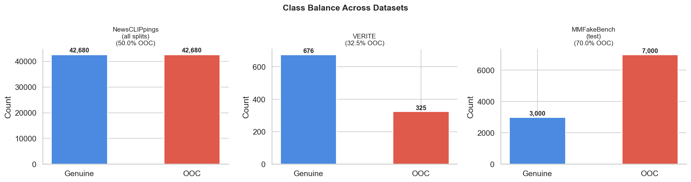

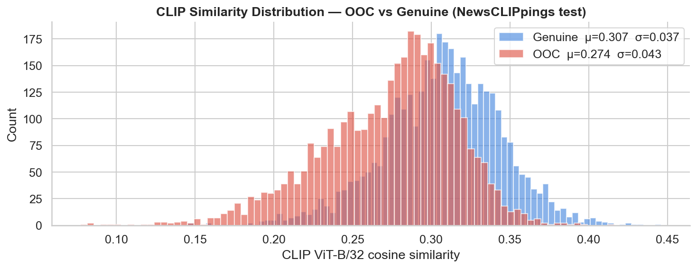

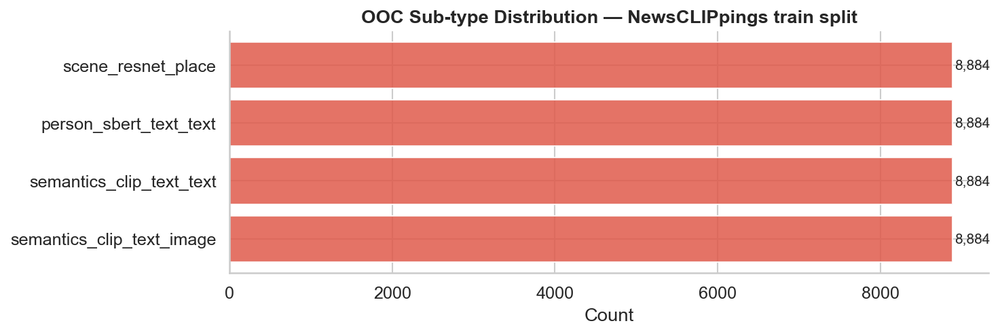

### NER / entity figures

| Figure | Path | Purpose |
|---|---|---|
| Entity count histogram | `paper/figures/ner_entity_count_histogram.png` | Shows number of entities per caption. |
| Entity distribution | `paper/figures/ner_entity_distribution.png` | Shows entity type distribution. |
| Entity OOC vs genuine | `paper/figures/ner_entity_ooc_vs_genuine.png` | Compares entity richness by class. |

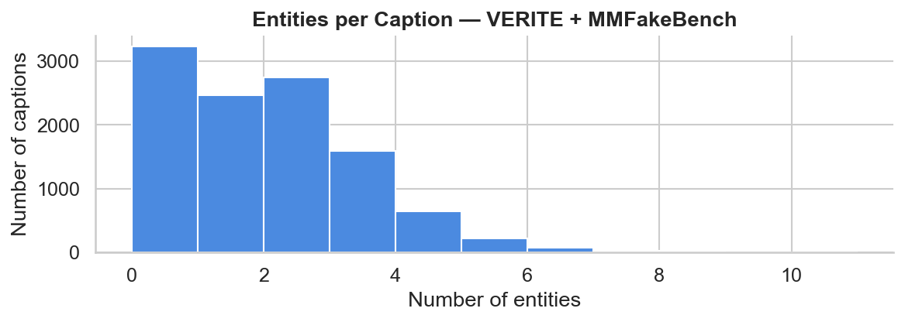

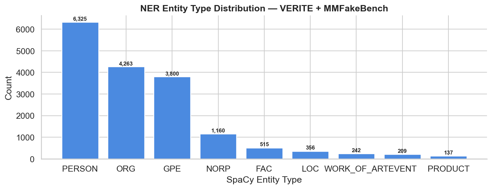

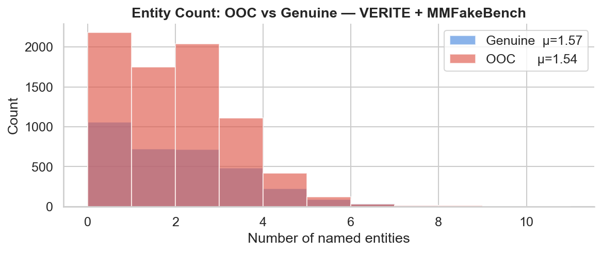

### Visual grounding figures

| Figure | Path | Purpose |
|---|---|---|
| VG score distribution | `paper/figures/vg_score_distribution.png` | Distribution of visual grounding scores. |
| VG OOC vs genuine | `paper/figures/vg_score_ooc_vs_genuine.png` | Visual grounding separation by class. |

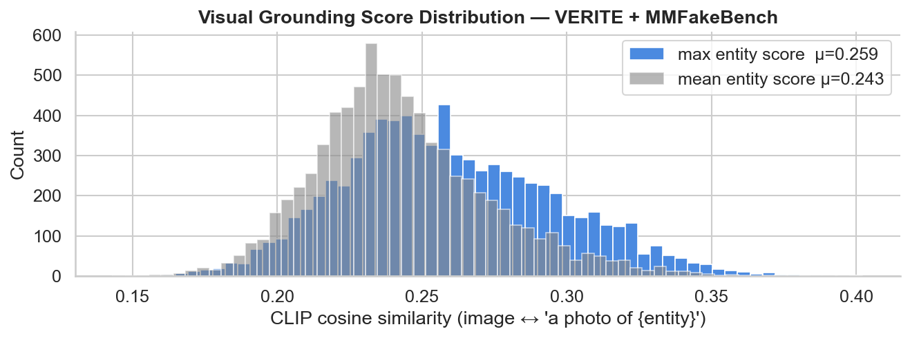

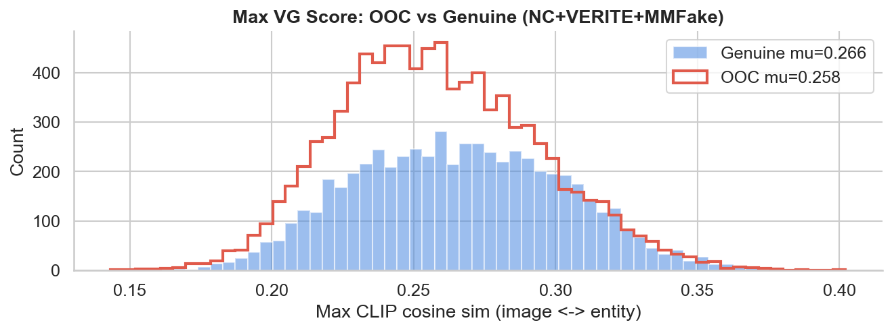

### Entity scorer figures

| Figure | Path | Purpose |
|---|---|---|
| Feature distributions | `paper/figures/entity_scorer_feature_distributions.png` | Stream A feature distributions. |
| Entity scorer ROC | `paper/figures/entity_scorer_roc.png` | Entity scorer ROC curve. |

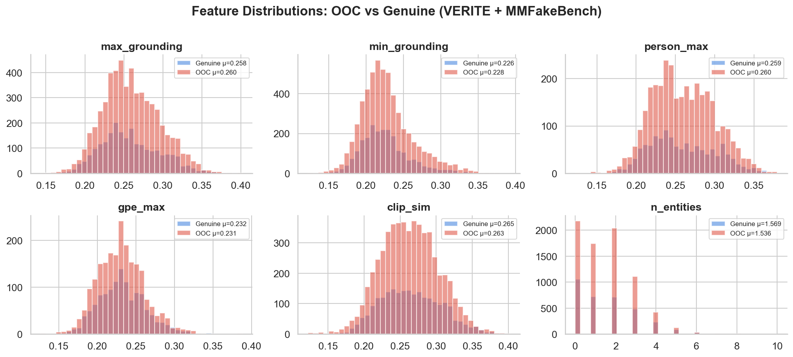

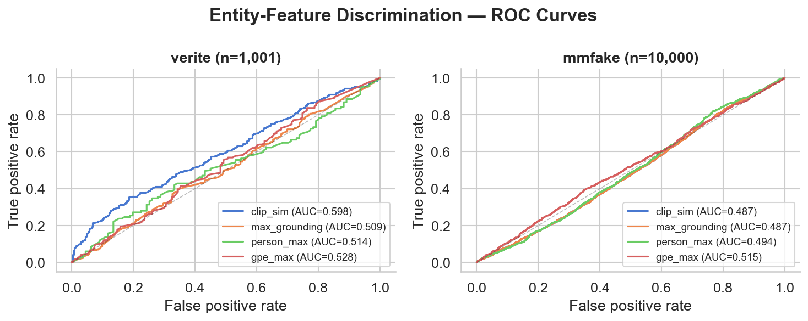

### Stream A figures

| Figure | Path | Purpose |
|---|---|---|
| Stream A confusion | `paper/figures/stream_a_confusion.png` | Stream A confusion matrix. |
| Stream A feature heatmap | `paper/figures/stream_a_feature_heatmap.png` | Feature correlation/importance. |
| Stream A ROC | `paper/figures/stream_a_roc.png` | Stream A ROC curve. |
| Stream A summary | `paper/figures/stream_a_summary_bar.png` | Stream A metrics summary. |

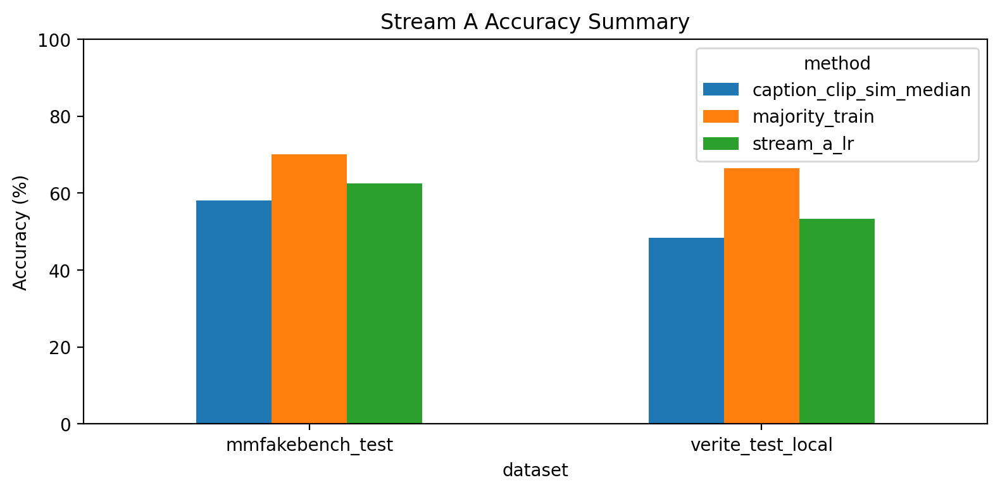

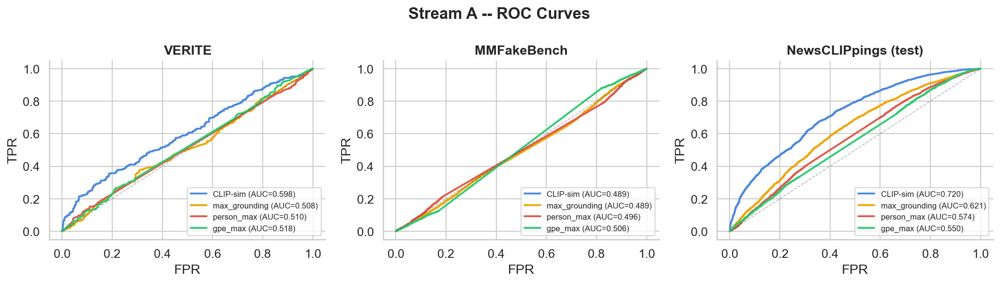

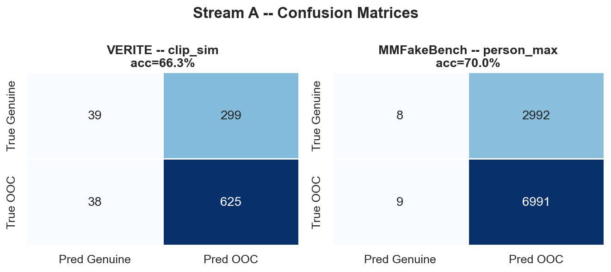

### Stream B figures

| Figure | Path | Purpose |
|---|---|---|
| Stream B confusion | `paper/figures/stream_b_confusion.png` | Stream B confusion matrix. |
| LoRA stage 1 training | `paper/figures/stream_b_lora_stage1_training.png` | Stage 1 training curves. |
| LoRA stage 2 training | `paper/figures/stream_b_lora_stage2_training.png` | Stage 2 training curves. |
| Stream B ROC | `paper/figures/stream_b_roc.png` | Stream B ROC curve. |
| Score distributions | `paper/figures/stream_b_score_distributions.png` | Stream B score distributions. |
| Stream B summary | `paper/figures/stream_b_summary_bar.png` | Stream B metric summary. |
| Stream B t-SNE | `paper/figures/stream_b_tsne.png` | Feature space visualization. |

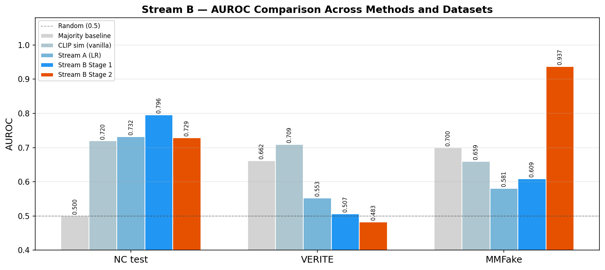

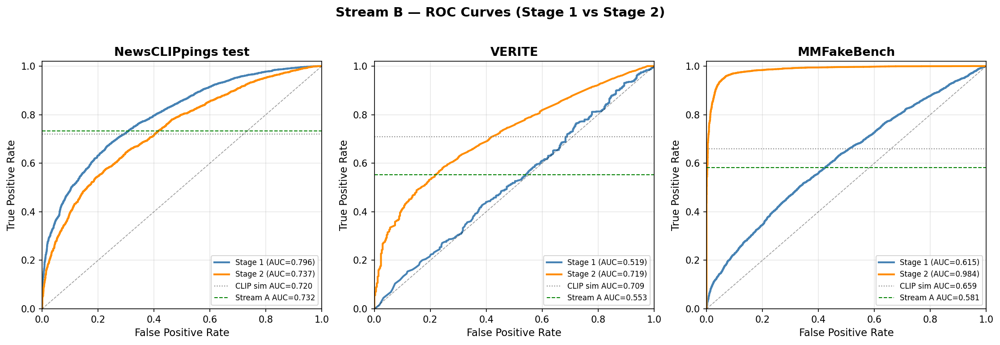

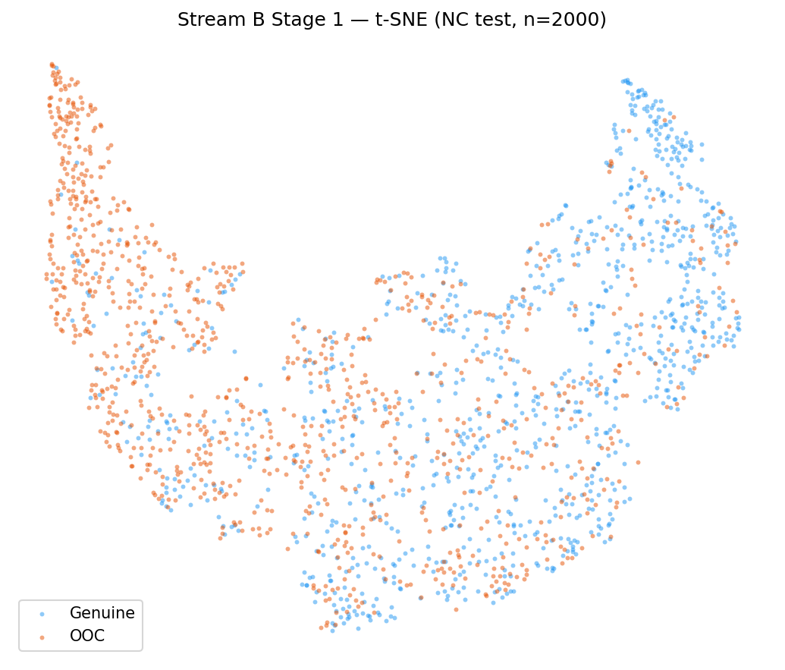

### Stream C figures

| Figure | Path | Purpose |
|---|---|---|
| Evidence distributions | `paper/figures/stream_c_evidence_distributions.png` | Distribution of evidence features. |
| Feature importance | `paper/figures/stream_c_feature_importance.png` | Stream C feature importance. |
| Stance distributions | `paper/figures/stream_c_stance_distributions.png` | Support/contradiction score distributions. |

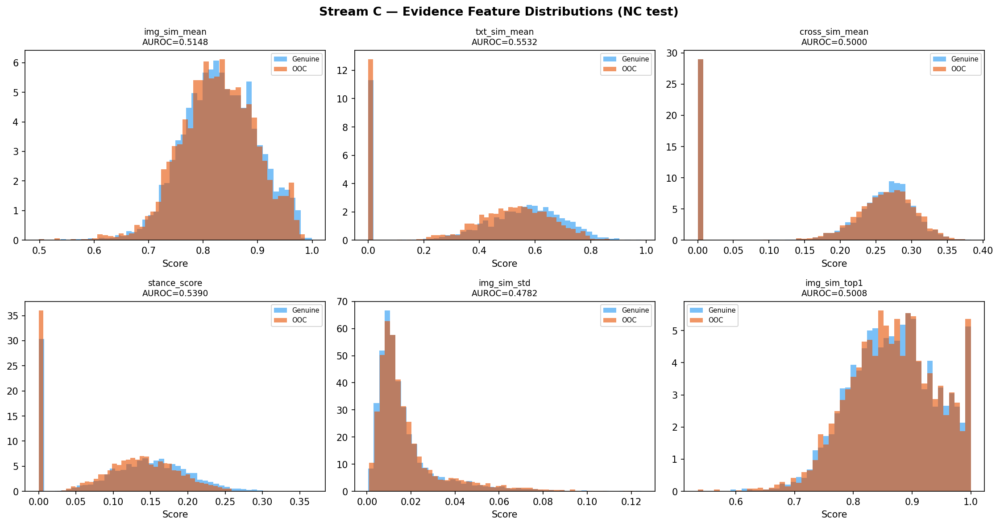

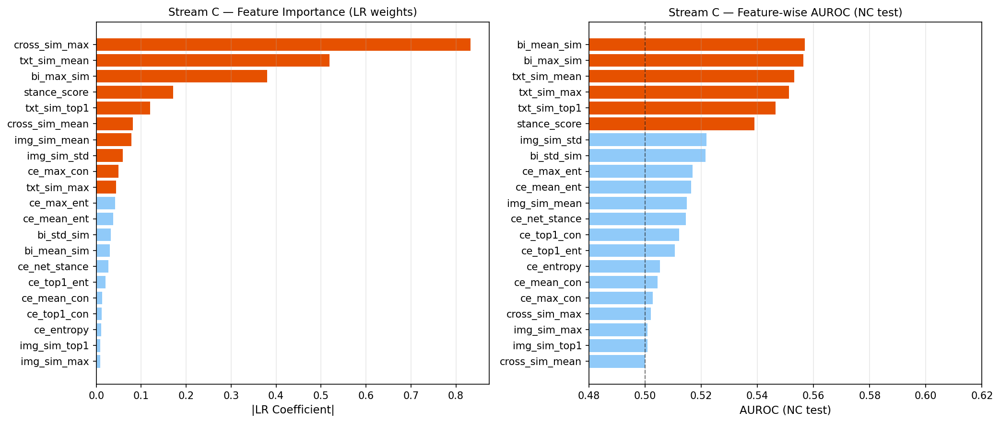

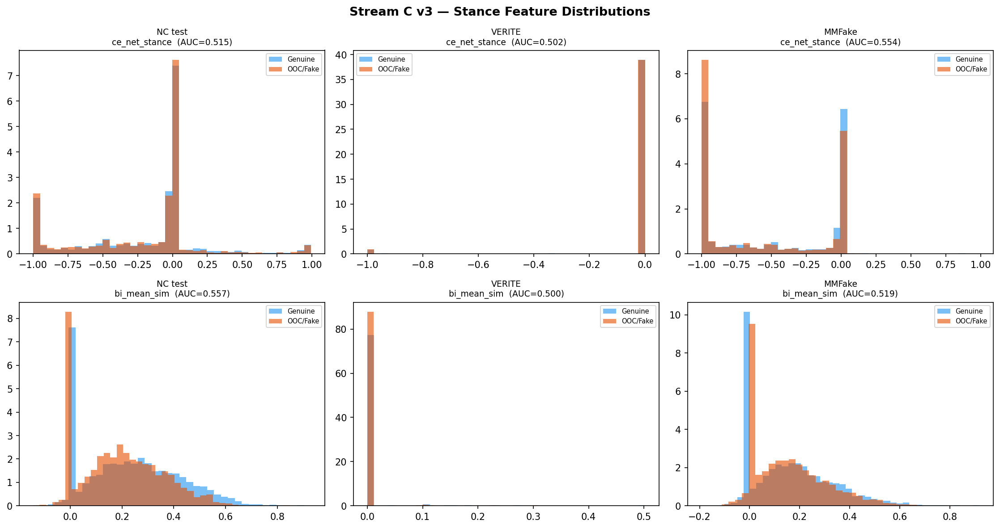

## Key tables currently expected

| Table | Path | Purpose |
|---|---|---|
| Dataset summary | `paper/tables/dataset_summary.csv` | Dataset row counts and metadata. |
| Class balance | `paper/tables/class_balance.csv` | Label distribution. |
| VERITE label distribution | `paper/tables/verite_label_distribution.csv` | VERITE label counts. |
| MMFakeBench label distribution | `paper/tables/mmfakebench_label_distribution.csv` | MMFakeBench label counts. |
| MMFakeBench fake class distribution | `paper/tables/mmfakebench_fake_cls_distribution.csv` | Fake subtype counts. |
| CLIP similarity | `paper/tables/clip_similarity_newsclip_test.csv` | CLIP similarity statistics. |
| CLIP threshold scan | `paper/tables/clip_threshold_scan_newsclip_test.csv` | Threshold sweep. |
| NER entity stats | `paper/tables/ner_entity_stats.csv` | Entity extraction summary. |
| NER entity richness | `paper/tables/ner_entity_richness_ooc_vs_genuine.csv` | Entity richness by class. |
| Visual grounding stats | `paper/tables/vg_stats.csv` | Visual grounding summary. |
| Entity scorer feature stats | `paper/tables/entity_scorer_feature_stats.csv` | Stream A feature statistics. |
| Entity scorer discrimination | `paper/tables/entity_scorer_discrimination.csv` | Stream A discrimination metrics. |
| Stream A results | `paper/tables/stream_a_results.csv` | Stream A evaluation. |
| Stream A vs baseline | `paper/tables/stream_a_vs_baseline.csv` | Stream A compared to baseline. |
| Stream A VERITE predictions | `paper/tables/stream_a_verite_predictions.csv` | VERITE row-level predictions. |
| Stream B accuracy | `paper/tables/stream_b_accuracy.csv` | Stream B accuracy summary. |
| Stream B feature selection | `paper/tables/stream_b_feature_selection.csv` | Selected Stream B features. |
| Stream B results | `paper/tables/stream_b_results.csv` | Stream B evaluation. |
| VERITE embedding stats | `paper/tables/verite_embedding_stats.csv` | VERITE embedding statistics. |

---

# 9. Output summary so far

The strongest confirmed result so far is the dataset cleanup and normalization.

## Confirmed processed dataset results

| Output | Value |
|---|---:|
| Total manifest rows | 97,361 |
| Rows with local images | 11,621 |
| Flat image files | 11,495 |
| Unique image IDs in `all.csv` | 83,461 |
| Broken image paths | 0 |
| Empty captions | 0 |

## Confirmed per-dataset results

| Dataset | Rows | Local image rows | Notes |
|---|---:|---:|---|
| NewsCLIPpings train | 71,072 | 0 | Embedding-only |
| NewsCLIPpings val | 7,024 | 0 | Embedding-only |
| NewsCLIPpings test | 7,264 | 0 | Embedding-only |
| VERITE test | 1,001 | 621 | Partial local coverage |
| MMFakeBench val | 1,000 | 1,000 | Full local images |
| MMFakeBench test | 10,000 | 10,000 | Full local images |

## Confirmed data quality results

| Check | Result |
|---|---|
| Manifest captions | No empty captions |
| Image paths | 0 broken image paths |
| Processed images | Flat folder created |
| VERITE duplicate raw paths | Resolved through manifest |
| MMFakeBench nested folders | Flattened into unique processed filenames |
| NewsCLIPpings missing local images | Explicitly represented as embedding-only |

## Model/output status

Earlier paper figures and tables exist for EDA, Stream A, Stream B, and some Stream C reporting. However, after the dataset restructure, these outputs should be considered **pre-cleanup outputs** until the relevant notebooks are rerun on the new manifest layer.

Recommended interpretation:

```text
Existing figures/tables = useful previous outputs
New processed manifests = canonical dataset source going forward
Next step = rerun Stream A/B/C notebooks from manifest layer
```

---

# 10. Issues faced and how we solved them

## Issue 1: VERITE images existed in duplicated locations

Problem:

```text
data/verite/image-text-verification/VERITE/images/
data/verite/images/
```

These folders had overlapping images. One was incomplete.

Solution:

- Moved raw data under `data/raw/`.
- Chose canonical raw VERITE path:

```text
data/raw/verite/image-text-verification/VERITE/images/
```

- Built processed image layer from canonical raw path.
- Stopped using the old duplicate path.

## Issue 2: VERITE image coverage was misunderstood

At one point, the project expected around 663 images. After validation, the actual final processed result is:

```text
621 VERITE rows with local images
495 unique VERITE processed image files
```

This is not a contradiction because VERITE reuses images across multiple rows. Example pattern:

```text
row 0 → true_0.jpg
row 1 → true_0.jpg
row 2 → false_0.jpg
```

Solution:

- Use `has_image` at the row level.
- Use `image_id` at the unique image level.
- Report both row coverage and unique image count.

## Issue 3: NewsCLIPpings local images are unavailable

Problem:

NewsCLIPpings rows reference VisualNews image paths, but local VisualNews images are not available in this project.

Solution:

- Set `has_image = 0`.
- Leave `image_path` blank.
- Preserve:
  - `raw_image_path`
  - `source_image_id`
  - `clip_image_key`
  - `clip_text_key`
- Use pre-extracted embeddings for Stream B and other NewsCLIPpings processing.

## Issue 4: MMFakeBench had deeply nested folders

Problem:

MMFakeBench raw image paths looked like:

```text
/real/bbc_test_500/bbc_test_0.png
/fake/antifact_image_generation_test_500/...
```

This produced many subfolders.

Solution:

- Copy MMFakeBench images into one flat processed image folder.
- Prefix filenames with dataset/split/path information, e.g.:

```text
mmfakebench_test_real_bbc_test_500_bbc_test_0.png
```

This prevents collisions and makes processing simple.

## Issue 5: Pandas JSON loading failed for NewsCLIPpings

Problem:

`pd.read_json()` failed with:

```text
ValueError: Mixing dicts with non-Series may lead to ambiguous ordering.
```

Reason:

NewsCLIPpings JSON is a dictionary with wrappers like:

```text
source_datasets
annotations
```

Solution:

- Use Python `json.load()`.
- Extract `annotations`.
- Convert the list/dict into records manually.

## Issue 6: PowerShell rejected Bash heredoc commands

Problem:

Commands like:

```bash
python - <<'PY'
```

failed in PowerShell.

Solution:

Use PowerShell-safe file writing:

```powershell
@'
python code here
'@ | Set-Content script.py

python script.py
```

## Issue 7: Python backslash escaping caused syntax errors

Problem:

Notebook cells accidentally contained:

```python
replace('\', '/')
```

This is invalid Python because the backslash escapes the quote.

Solution:

Use:

```python
replace("\\", "/")
```

This was fixed in the dataset builder code.

## Issue 8: Old processed image folders still existed

Problem:

The earlier processed structure had nested folders such as:

```text
data/processed/ooc_pairs/images/mmfakebench/test/fake/...
data/processed/ooc_pairs/images/verite/...
```

But the new target is a flat image folder.

Solution:

The cleanup cell in the flat dataset notebook removes old processed image folders and rebuilds:

```text
data/processed/ooc_pairs/images/
```

as a single flat folder.

## Issue 9: Old caches were stale

Problem:

Caches from previous VERITE image coverage and old paths were stale.

Examples:

```text
cache/visual_grounding/vg_verite.pkl
cache/entity_scorer/features_verite.pkl
cache/lora_stage2/ood_embs_verite.pkl
```

Solution:

- Move caches into stream-specific folders.
- Delete stale VERITE-derived caches before rerunning notebooks.
- Rebuild caches from the processed manifest layer.

## Issue 10: Paper figures/tables may be outdated

Problem:

Figures/tables were generated before the final dataset cleanup.

Solution:

- Keep them as previous outputs.
- Rerun paper notebooks after Stream A/B/C are rerun from the new manifests.
- Use `paper/figures/` and `paper/tables/` as final output locations.

---

# 11. How to use the project now

## Load paths

Use:

```python
from src.utils.paths import (
    MANIFESTS,
    PROCESSED_IMAGES,
    TRAIN_MANIFEST,
    VAL_MANIFEST,
    TEST_MANIFEST,
    VERITE_TEST_MANIFEST,
    MMFAKEBENCH_VAL_MANIFEST,
    MMFAKEBENCH_TEST_MANIFEST,
    ALL_MANIFEST,
)
```

## Load manifests

```python
import pandas as pd

train_df = pd.read_csv(TRAIN_MANIFEST, low_memory=False)
val_df = pd.read_csv(VAL_MANIFEST, low_memory=False)
test_df = pd.read_csv(TEST_MANIFEST, low_memory=False)
verite_df = pd.read_csv(VERITE_TEST_MANIFEST, low_memory=False)
mmfake_val_df = pd.read_csv(MMFAKEBENCH_VAL_MANIFEST, low_memory=False)
mmfake_test_df = pd.read_csv(MMFAKEBENCH_TEST_MANIFEST, low_memory=False)
all_df = pd.read_csv(ALL_MANIFEST, low_memory=False)
```

## Get rows with local images

```python
df_img = all_df[all_df["has_image"] == 1].copy()
```

## Convert image paths to absolute paths

```python
from pathlib import Path
from src.utils.paths import ROOT

df_img["abs_image_path"] = df_img["image_path"].map(lambda p: ROOT / p)
```

## Use NewsCLIPpings embeddings

For NewsCLIPpings:

```python
news_df = all_df[all_df["dataset"] == "newsclippings"].copy()
```

Use:

```python
clip_image_key
clip_text_key
```

rather than `image_path`.

## Use VERITE and MMFakeBench images

For local-image datasets:

```python
local_img_df = all_df[
    (all_df["has_image"] == 1)
    & (all_df["dataset"].isin(["verite", "mmfakebench"]))
].copy()
```

---

# 12. Important implementation notes

## Do not scan raw folders in modeling notebooks

Model notebooks should not manually search:

```text
data/raw/
```

Instead, they should use:

```text
data/processed/ooc_pairs/manifests/
```

This makes experiments reproducible.

## Do not manually assume image filenames

Do not assume image names like:

```text
0000.jpg
true_0.jpg
bbc_test_0.png
```

Always read:

```python
row["image_path"]
```

from the manifest.

## Use `pair_id` for row-level caches

Each image-caption pair has a unique `pair_id`.

Use it when saving:

- predictions,
- feature rows,
- NER results,
- evidence results,
- stance scores.

## Use `image_id` for image-level caches

The same image may be used by multiple rows.

Use `image_id` when saving:

- image embeddings,
- visual grounding image features,
- image-only features.

## Keep raw data unchanged

Raw data should preserve original dataset format.

Do not delete:

```text
data/raw/verite/image-text-verification/VERITE/images/true_*.jpg
data/raw/verite/image-text-verification/VERITE/images/false_*.jpg
```

because VERITE CSV references those names.

## Keep generated outputs separate

Recommended output policy:

```text
cache/       = intermediate features/predictions
paper/       = final tables and figures
experiments/ = run-specific logs/checkpoints
```

## GitHub note

Large raw data and cache files usually should not be committed. The repository can commit:

- source code,
- notebooks,
- configs,
- README,
- GRAND_PLAN,
- small result tables,
- final figures.

Large data/caches should be stored externally or ignored depending on GitHub size limits.

---

# 13. Glossary

## OOC

**Out-of-context.**  
An image is paired with a misleading or mismatched caption/context.

## Match

A correct image-text pair. Label `0`.

## Mismatch

An incorrect or out-of-context image-text pair. Label `1`.

## Manifest

A CSV file that describes dataset rows. It contains paths, captions, labels, IDs, and metadata.

## Raw data

Original downloaded dataset files. Stored under:

```text
data/raw/
```

## Processed data

Clean normalized project data. Stored under:

```text
data/processed/ooc_pairs/
```

## Flat image folder

A single folder containing all processed local images:

```text
data/processed/ooc_pairs/images/
```

No nested dataset folders are needed because filenames are made unique.

## `pair_id`

Unique row ID for an image-text pair.

Example:

```text
nc_620701_0
verite_0000
mmfakebench_test_00000
```

## `image_id`

Unique processed image ID.

Example:

```text
verite_true_0
mmfakebench_test_real_bbc_test_500_bbc_test_0
```

## `has_image`

Whether a row has a local processed image file.

```text
1 = image exists locally
0 = no local image
```

## `image_path`

Path to the processed image if available.

Example:

```text
data/processed/ooc_pairs/images/verite_true_0.jpg
```

## `raw_image_path`

Original path/reference from the raw dataset.

Example:

```text
images/true_0.jpg
/real/bbc_test_500/bbc_test_0.png
visual_news/origin/guardian/images/0540/632.jpg
```

## `clip_image_key`

Key used to find pre-extracted image embeddings.

Especially important for NewsCLIPpings.

## `clip_text_key`

Key used to find pre-extracted text embeddings.

Especially important for NewsCLIPpings.

## NER

Named Entity Recognition.  
Extracts entities such as people, organizations, locations, and dates.

## Visual grounding

Checking whether text entities or concepts are visually supported by the image.

## CLIP

A model that embeds images and text into a shared representation space.

## LoRA

Low-Rank Adaptation.  
A parameter-efficient fine-tuning method.

## RAG

Retrieval-Augmented Generation or Retrieval-Augmented Reasoning.  
Uses retrieved evidence to improve prediction or explanation.

## Stance scoring

Determining whether evidence supports, contradicts, or is neutral toward a claim/caption.

## Stream A

Entity verification stream.

## Stream B

CLIP / LoRA multimodal representation stream.

## Stream C

Evidence retrieval and stance reasoning stream.

## Fusion

Combining outputs/features from multiple streams into one final prediction.

## MLLM

Multimodal Large Language Model.  
A model that can reason over text and images.

---

# 14. Beginner mental model

A beginner should understand the project like this:

## Step 1: Data is normalized

All datasets are converted into rows like:

```text
pair_id, image_path, caption, label
```

The main files are:

```text
data/processed/ooc_pairs/manifests/*.csv
```

## Step 2: Images are centralized

All available local images are copied into:

```text
data/processed/ooc_pairs/images/
```

The manifest tells you which image belongs to which row.

## Step 3: Some rows do not have local images

NewsCLIPpings rows have no local images. That is expected.

They use embedding keys instead.

## Step 4: Models are organized into streams

- Stream A checks entities.
- Stream B checks multimodal embeddings.
- Stream C checks evidence.
- Fusion combines them.

## Step 5: Outputs go to paper folders

Figures:

```text
paper/figures/
```

Tables:

```text
paper/tables/
```

## Step 6: Never trust old raw paths

Always use the processed manifest.

---

# 15. Next steps

## Immediate next steps

1. Commit the clean directory structure.
2. Keep `00_make_flat_processed_dataset.ipynb` as the official dataset builder.
3. Update `src/utils/paths.py`.
4. Rerun `env_check.ipynb`.
5. Rerun `eda.ipynb` using processed manifests.
6. Update Stream A notebooks to read manifests.
7. Delete or invalidate stale Stream A caches.
8. Rerun Stream A.
9. Update Stream B notebooks to read manifests.
10. Rerun Stream B.
11. Update Stream C notebooks to read manifests.
12. Rerun Stream C.
13. Regenerate paper tables and figures.

## Recommended notebook rerun order

```text
1. notebooks/00_make_flat_processed_dataset.ipynb
2. notebooks/01_setup/env_check.ipynb
3. notebooks/01_setup/eda.ipynb
4. notebooks/02_stream_a/ner_pipeline_v2.ipynb
5. notebooks/02_stream_a/visual_grounding_v2.ipynb
6. notebooks/02_stream_a/stream_a_results_v2_fixed.ipynb
7. notebooks/03_stream_b/clip_features.ipynb
8. notebooks/03_stream_b/lora_stage1.ipynb
9. notebooks/03_stream_b/lora_stage2_fixed.ipynb
10. notebooks/03_stream_b/stream_b_results_fixed.ipynb
11. notebooks/04_stream_c/evidence_retrieval_patch_fixed.ipynb
12. notebooks/04_stream_c/stance_scoring_fixed.ipynb
13. notebooks/04_stream_c/stream_c_results_fixed.ipynb
14. notebooks/05_fusion/baselines_fixed.ipynb
15. notebooks/05_fusion/fusion_module.ipynb
16. notebooks/05_fusion/fusion_training.ipynb
17. notebooks/07_eval/newsclippings_eval.ipynb
18. notebooks/07_eval/cross_dataset_eval.ipynb
19. notebooks/07_eval/ablations.ipynb
20. notebooks/08_paper/tables.ipynb
21. notebooks/08_paper/figures.ipynb
```

## Final principle

The project should now be treated as:

```text
Raw datasets are only sources.
Processed manifests are the truth.
Notebooks should never hardcode raw paths again.
```

---

# End of GRAND_PLAN.md
